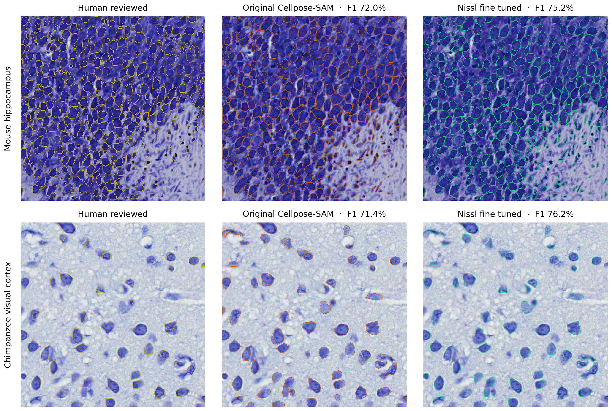

# Cellpose-SAM Nissl fine-tuning pilot

13 November 2026. A separate Cellpose-SAM checkpoint was fine-tuned on a small subset of the [CytoDArk0 expert-reviewed Nissl dataset](https://zenodo.org/records/13694738). The built-in Cellpose-SAM weights and all existing CellMatchR projects remain unchanged.

## Held-out design

The 28 local 512 × 512 patches came from seven distinct 1024 × 1024 source images. All four quadrants of each source stayed in one split to prevent an adjacent quadrant from appearing in both training and evaluation. The reference outlines include both neurons and glia; the model should be checked against the lab's intended cell population before use.

| Split | Source image IDs | Patches | Human-labeled cells |
| --- | --- | ---: | ---: |
| Training | 1, 54, 55, 66 | 16 | 7,752 |
| Validation for checkpoint selection | 28 | 4 | 404 |
| Final held-out test | 58, 62 | 8 | 1,592 |

The models received native grayscale images normalized from the 0.5th to 99.8th percentile, matching the earlier Cellpose-SAM baseline. A prediction matched at most one human cell at intersection-over-union ≥ 0.5. The numbers below score raw model proposals **before** CellMatchR's object filters. Only the validation split was used to choose the checkpoint; the test split was scored once after choosing six epochs.

## Results

Training used the existing CellMatchR Cellpose-SAM trainer, a 1 × 256 × 256 patch batch, learning rate `1e-5`, and Apple Metal. The three-epoch and six-epoch candidates both started from the original `cpsam` weights with random seed 24. Six epochs gave the better validation F1.

| Split | Original Cellpose-SAM | Three epochs | Selected six epochs |
| --- | ---: | ---: | ---: |
| Validation F1 | 77.52% | 78.69% | **81.50%** |
| Held-out test F1 | 74.04% | Not tested | **75.80%** |

On the final test, precision rose from **82.9% to 85.7%** and recall from **66.9% to 68.0%**. The model matched 1,082 of 1,592 labeled cells, versus 1,065 for the original. Mouse hippocampus F1 rose from **73.47% to 74.73%**; chimpanzee visual cortex rose from **77.02% to 82.01%**. One of the eight individual patches declined slightly, so the aggregate improvement is not uniform. Two held-out source images are too few to establish broad transfer to other species, stains, scanners, or the lab's incoming slides. These scores are not a statistical significance claim.

[Single-page PDF of the comparison](docs/Nissl_gold_standard_finetuning_comparison.pdf). The two displayed patches are from different held-out source images; the table above pools all eight held-out patches.

## Saved model and app use

The selected model is saved as **Nissl CytoDArk0 pilot (6 epochs)** in the shared CellMatchR library:

`~/CellMatchR/Models/cellpose_ch0_nissl_cytodark_pilot_20261113_072658/trained_model`

Checkpoint SHA-256: `6be1bc9dcf5574a80b0b4667a707c4ace8d8b462e12c6d6c6ddc9b9b7d050f15` (1.2 GB). Its `model.json` records the training, validation, and test source images and scores. The model is local to this computer; Git contains the experiment scripts and report, but not the checkpoint or dataset images.

In **Step 3 → Cellpose → Model for this run**, choose the named pilot model. It is listed for all projects and remains available as a starting model for later Step 7 fine-tuning. It was **not** made the default or selected automatically in any project. For an 8-bit grayscale Nissl TIFF, the smoke test used `raw_percentile`, minimum object size 20 pixels, and raw mean minimum 0. Those are test settings, not validated production defaults. Native RGB slide-scanner input still needs an explicit brightfield route; the fluorescence processing methods were not changed.

A normal CellMatchR segmentation command loaded the saved model from the shared library and wrote a prediction TIFF and QC images on a held-out Nissl patch. The full test suite passed 82 tests, including older-project compatibility checks.

## Reproduction and limitations

The [training and scoring script](benchmark_data/finetune_cytodark.py) fixes the source-image split and metric. The [figure script](benchmark_data/render_finetuning_comparison.py) renders the two visual comparisons. The 28 image/mask pairs and compact baseline score JSON are local in [benchmark_data/CytoDArk0_subset](benchmark_data/CytoDArk0_subset/README.md) and excluded from Git; download the original from Zenodo if reproducing on another computer. Disposable training checkpoints and segmentation outputs were removed after the selected model was saved.
The [per-patch score audit](benchmark_data/CytoDArk0_finetuning_scores.json) is included in Git without the large images or checkpoint.
