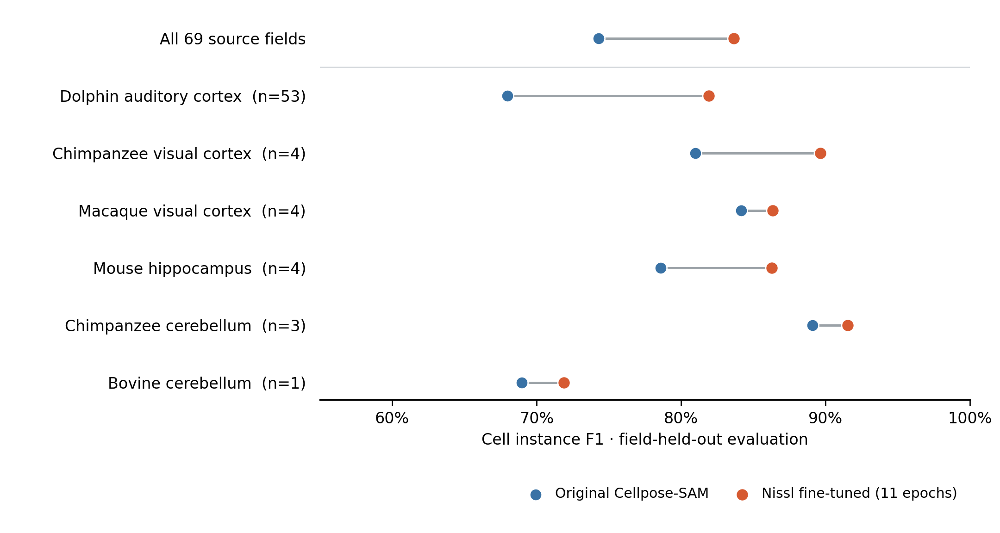

# Nissl General v1: full CytoDArk0 fine-tuning

13 November 2026. Cellpose-SAM was fine-tuned with all 69 original 20× Nissl fields from the [CytoDArk0 expert-annotated dataset](https://zenodo.org/records/13694738). The dataset labels both neurons and glia. This model is an additional, optional choice in CellMatchR; the built-in Cellpose-SAM and the earlier pilot model remain available.

## Held-out validation

Each 1024 × 1024 original field was divided into four 512 × 512 crops. All crops from a field stayed in one of four held-out folds (18, 17, 17, and 17 fields). The paired 40× views were excluded because they show the same tissue as 58 of the 20× fields. Every validation model started independently from the original `cpsam` weights, not the earlier pilot. After choosing the epoch count, a new model was trained on all 276 crops; that final checkpoint itself has no independent CytoDArk0 test set.

The four validation fits used Cellpose 4.1.1 on Apple Metal; the final all-image fit used the same Cellpose version on a Linux RTX 3090 with CUDA. All fits used learning rate `1e-5`, batch size 1, and 256 × 256 training patches. Sampling was half natural frequency and half balanced equally across the six species/brain-area groups because 53 of the 69 fields are dolphin auditory cortex. Images were converted to grayscale and normalized between the 0.5th and 99.8th percentiles, matching CellMatchR's `raw_percentile` mode.

Predictions were scored as raw cell instances before CellMatchR's object filters. Each proposed cell could match at most one human-labeled cell at intersection-over-union ≥ 0.5. The scores are patch-level instance F1; cells cut by a crop boundary can be counted in more than one crop.

| Held-out fold | Source fields | Original Cellpose-SAM F1 | 6 epochs F1 | 11 epochs F1 |
| --- | ---: | ---: | ---: | ---: |
| 0 | 18 | 68.64% | **79.00%** | 78.77% |
| 1 | 17 | 78.15% | 85.34% | **86.20%** |
| 2 | 17 | 75.52% | **85.04%** | 84.73% |
| 3 | 17 | 75.13% | 83.40% | **85.22%** |
| **Pooled** | **69** | **74.30%** | **83.04%** | **83.63%** |

The 11-epoch candidate had 89.62% precision and 78.39% recall, versus 82.81% and 67.37% for the original model. Its out-of-fold F1 improved on all 69 original fields. The median per-field gain was 11.0 percentage points (interquartile range 7.6–16.7); the smallest was 1.3 points. Eleven epochs was selected for the final all-image training.

| Tissue group | Fields | Original F1 | 11-epoch F1 |
| --- | ---: | ---: | ---: |
| Dolphin auditory cortex | 53 | 67.99% | 81.93% |
| Chimpanzee cerebellum | 3 | 89.08% | 91.55% |
| Chimpanzee visual cortex | 4 | 80.98% | 89.66% |
| Macaque visual cortex | 4 | 84.16% | 86.33% |
| Mouse hippocampus | 4 | 78.60% | 86.29% |
| Bovine cerebellum | 1 | 68.98% | 71.87% |

[Vector PDF of the validation figure](docs/Nissl_full_CytoDArk0_validation.pdf)

## Saved model and app check

The completed **Nissl General v1** checkpoint is a new shared-library model, saved on the Mac at:

`~/CellMatchR/Models/cellpose_ch0_nissl_general_v1_20261113_095825/models/trained_model`

The same model is on the lab PC under `/home/shiyuzhang/CellMatchR/Models/cellpose_ch0_nissl_general_v1_20261113_095825`. SHA-256 on both copies: `e152654196016dd8c0b0d02cf8b7f6e430dfc12b0685a1268fd45d07546514c4` (1.2 GB). Both `model.json` records identify 11 epochs and all 69 source fields; the Mac record points to the Mac file. The original built-in weights, the pilot model, and older project files were not changed.

CellMatchR's model registry finds the Mac copy as **Nissl General v1** in the shared library. On Linux, a full CellMatchR segmentation run loaded the final model and wrote a nonempty mask with 59 labels from a 512 × 512 Nissl TIFF. The smoke test used channel 0, `raw_percentile`, a 20-pixel minimum object size, and raw-mean minimum 0; these are test settings, not validated defaults for other slides.

In the feature-branch app, choose **Step 3 → Cellpose → Model for this run → Nissl General v1**. The model also appears as a starting point in Step 7 for further fine-tuning. It is listed in every project but is not selected automatically. The older `.app` under `/Users/szhang24/Desktop/CellMatchr` still launches the older Desktop code copy and does not have this model menu; use the feature-branch app for testing until the branch is approved.

## Interpretation and limits

This is a larger and more varied benchmark than the seven-field pilot, and the field-held-out result supports a useful improvement for the public Nissl images. The published metadata do not provide dependable animal IDs for every field, so these folds cannot establish generalization to a new animal. The dataset is dominated by dolphin auditory cortex; bovine cerebellum has only one original field. The human labels include glia as well as neurons, so the score should not be treated as a neuron-only counting result. Your incoming slides may differ in stain, scanner, and magnification and still need direct review against human annotations.

The current CellMatchR image-processing methods were not changed. A native RGB brightfield slide-scanner route has not yet been validated for this model; the benchmark uses grayscale Nissl images. Object filters and downstream analysis can change the final counts relative to these raw-model scores.

## Reproduction

The [selective downloader](benchmark_data/download_cytodark_20x.py) extracts just the 69 20× image/mask pairs and author metadata from the public archive. The [training and scoring script](benchmark_data/train_full_cytodark.py) records the fold assignments, per-patch scores, and all-image training settings. The [figure script](benchmark_data/render_full_cytodark_results.py) produces the PNG and PDF above. The [compact validation audit](benchmark_data/cytodark_full_results/summary.json), four fold files, and [final training record](benchmark_data/cytodark_full_results/final_model.json) are included in Git; source images and large model checkpoints stay local. The existing test suite passed all 82 tests after these changes.
