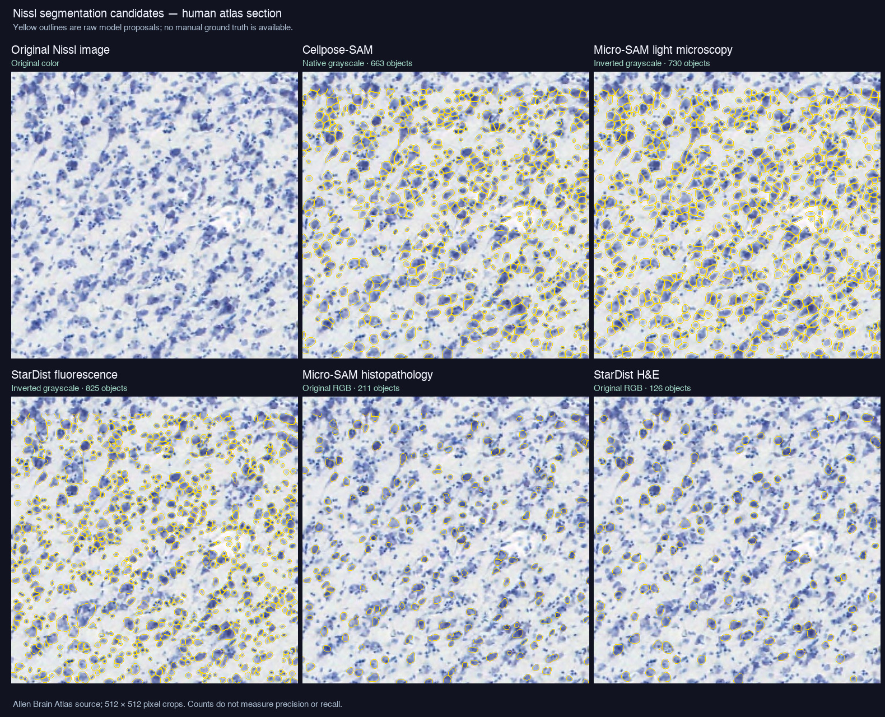
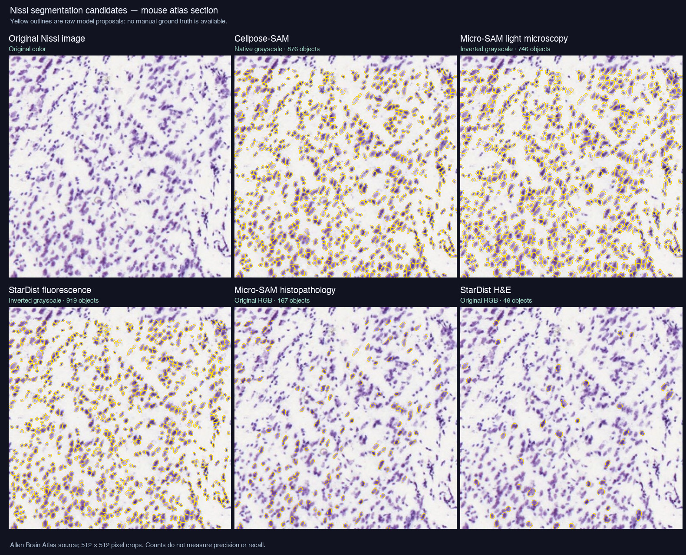

# Exploratory Nissl slide-scan model check

12–13 November 2026. The first section is a visual comparison of public atlas images. The second section measures accuracy against expert-reviewed Nissl cell outlines from CytoDArk0. Neither public source is a substitute for checking the lab's incoming slides.

## Expert-annotated Nissl comparison

[CytoDArk0](https://zenodo.org/records/13694738) provides 38,755 individually outlined neurons and glia in Nissl-stained brain images. Its team reviewed and corrected the cell outlines. I used 28 of its 512 × 512 patches at 20× magnification, comprising 9,748 annotated cells. These 28 patches are four quadrants each of seven distinct 1024 × 1024 source images: IDs 1 and 28 (dolphin auditory cortex), 54 (bovine cerebellum), 55 (chimpanzee cerebellum), 58 (mouse hippocampus), 62 (chimpanzee visual cortex), and 66 (macaque visual cortex). This is a deliberately small, cross-species sample, and quadrants from the same image are correlated. It is **not** the dataset authors' held-out test split.

I matched each predicted cell to at most one annotated cell at intersection-over-union ≥ 0.5. Precision is correct predictions divided by all predictions; recall is correctly found annotated cells divided by all annotations; F1 balances the two. Scores pool the 28 patches. The model outputs were scored **before** CellMatchR's fluorescence-oriented size and intensity filters. Cellpose-SAM and Micro-SAM received CellMatchR-style 0.5–99.8 percentile normalized grayscale; StarDist used its standard 1–99.8 normalization. Cellpose 2 and the rat model were run with a 30-pixel expected diameter, their built-in value. “Inverted” makes the dark Nissl stain bright. These are model comparisons, not proof that a direct brightfield file already passes through the default pipeline. The 28 local image/mask pairs and per-patch scores are in [benchmark_data/CytoDArk0_subset](benchmark_data/CytoDArk0_subset/README.md); the data files are deliberately excluded from Git.

| Model and input | Predicted cells | Matched cells | Precision | Recall | F1 |
| --- | ---: | ---: | ---: | ---: | ---: |
| Cellpose-SAM, native grayscale | 8,619 | 7,186 | 83.4% | 73.7% | **78.3%** |
| Cellpose-SAM, inverted grayscale | 8,913 | 7,356 | 82.5% | 75.5% | **78.8%** |
| Micro-SAM `vit_b_lm`, inverted | 8,881 | 4,490 | 50.6% | 46.1% | 48.2% |
| StarDist `2D_versatile_fluo`, inverted | 7,076 | 2,878 | 40.7% | 29.5% | 34.2% |
| Cellpose 2 `cyto2`, native | 4,049 | 1,438 | 35.5% | 14.8% | 20.9% |
| Cellpose 2 `cyto2`, inverted | 4,056 | 1,828 | 45.1% | 18.8% | 26.5% |
| Meystre et al. rat Nissl v2, native | 4,934 | 2,077 | 42.1% | 21.3% | 28.3% |
| Meystre et al. rat Nissl v2, inverted | 2,224 | 69 | 3.1% | 0.7% | 1.2% |

**Practical reading:** Cellpose-SAM is the strongest of these candidates on this annotated public sample. Its native and inverted results are close; native avoids an extra input transformation. Cellpose 2 and the paper's rat model miss many annotated cells here. The [paper model](https://www.frontiersin.org/journals/neuroanatomy/articles/10.3389/fnana.2024.1463632/full) was fine-tuned for juvenile rat cresyl-violet images at a specific resolution and typical cell size, so this cross-species result does not establish its performance on matching rat slides. Its published overlap figures used a different measure and data, and must not be compared numerically with this F1 table. The paper's [released weights](https://github.com/BlueBrain/layer-recognition) load in an isolated Cellpose 3 runtime; CellMatchR's installed Cellpose 4 reports that these older weights are incompatible.

## Images and method

I used two full-resolution Nissl atlas sections exposed by the [Allen Brain Atlas image API](https://alleninstitute.github.io/AllenSDK/allensdk.api.queries.image_download_api.html): [human atlas image 112282603](https://api.brain-map.org/api/v2/atlas_image_download/112282603?downsample=6&annotation=false) and [mouse atlas image 100960248](https://api.brain-map.org/api/v2/atlas_image_download/100960248?downsample=5&annotation=false). The [AllenSDK example](https://alleninstitute.github.io/AllenSDK/_static/examples/nb/image_download.html) identifies the first as a Nissl section; the [Allen download tutorial](https://brain-map.org/support/tutorials/downloading-an-image) documents the mouse image ID and full-resolution crop parameters. I downloaded 1024 × 1024 regions, then compared 512 × 512 cell-level crops. The API coordinates at full resolution were human dense `(10256, 15256)`, human layer `(33032, 17032)`, and mouse `(7756, 4456)` (left, top).

The models were Cellpose-SAM `cpsam` (Cellpose 4.1.1), Micro-SAM `vit_b_lm` and `vit_b_histopathology` (micro-sam 1.7.0), and StarDist `2D_versatile_fluo` and `2D_versatile_he` (StarDist 0.9.2). The [Micro-SAM documentation](https://computational-cell-analytics.github.io/micro-sam/) identifies `vit_b_histopathology` as an additional histopathology model. The [StarDist model list](https://github.com/stardist/stardist) identifies `2D_versatile_he` as a brightfield RGB model. Both are reasonable candidates to check, though neither was trained specifically on Nissl stain.

For each model I supplied the input it could use most plausibly: native grayscale for Cellpose-SAM, inverted grayscale for Micro-SAM light microscopy and StarDist fluorescence, and original RGB for the histopathology/H&E models. The Micro-SAM and Cellpose grayscale tests used CellMatchR's `raw_percentile` normalization. StarDist used its library's percentile normalization. Candidate outlines were recorded before CellMatchR's object-size and intensity filters. All comparison inference runs used CPU, default model thresholds, and no fine-tuning.

| Candidate and input | Human dense | Human layer | Mouse | Visual reading |
| --- | ---: | ---: | ---: | --- |
| Cellpose-SAM, native grayscale | 663 | 1,006 | 876 | Broad coverage with many boundaries around stained cell bodies; strongest initial candidate to validate. |
| Micro-SAM `vit_b_lm`, inverted grayscale | 730 | 913 | 746 | Many stained objects found, but some dense groups have broad or merged outlines. |
| StarDist fluorescence, inverted grayscale | 825 | 771 | 919 | Distinct small objects often separated cleanly; some larger or diffuse cells missed. |
| Micro-SAM `vit_b_histopathology`, original RGB | 211 | 64 | 167 | Misses many visible stained objects. |
| StarDist H&E, original RGB | 126 | 94 | 46 | Misses most visible stained objects. |

Counts are **raw proposals on equal-size crops**, not accuracy scores. Input polarity is decisive: the same Micro-SAM light-microscopy model found 171 and only 7 objects on the two human crops without inversion, versus 730 and 913 after inversion. StarDist fluorescence also outlined broad background regions on native grayscale and needed the inverted stain view.

## Pipeline and retraining checks

CellMatchR completed its full Micro-SAM segmentation command on an inverted grayscale 8-bit TIFF made from the human dense crop, saving a channel-0 prediction TIFF and QC images with 730 candidates. The same configured core tiling path produced 819 candidates with the real StarDist fluorescence model. This required an explicit `raw_percentile` choice, a 20-pixel minimum size, and a zero raw-mean intensity threshold. With the existing default `RAW_MEAN_MIN=5000`, a direct filter check removed **all 730** Micro-SAM candidates because the test image's maximum value was 204. The standard default size threshold of 1200 pixels is also too large for most cells in these test crops. The production preprocessing code was not changed for this experiment.

The quick editor has separate **add missed cell**, **erase whole object on touch**, and **Ctrl+Z before save** actions. Validation has **NO** and **ARTIFACT** decisions. The tests confirm that accepted added cells enter the training mask after focused review, while rejected cells become background in the temporary training mask and the project mask remains intact. I changed the collector to skip a sample containing **MAYBE** cells until those decisions are resolved; otherwise the ambiguous cells had been incorrectly treated as negative background. Step 7 now shows the number of YES and NO/ARTIFACT cells in ready samples.

Real one-epoch smoke tests on temporary reviewed synthetic samples produced new Cellpose-SAM, StarDist, and Micro-SAM models. Each saved model was then selected for a second training round, and the second-round Micro-SAM checkpoint also loaded successfully for new inference. The full test suite passed 78 tests, including checks that added cells become training targets, NO/ARTIFACT and erased predictions become staged background, and MAYBE cells are excluded until resolved. These checks verify the training and shared-model-library paths, **not improved Nissl performance**. Micro-SAM training used Apple Metal; the CPU-only trial made no progress through its first iteration in over ten minutes. The test model library and downloaded model weights were kept outside user projects and removed after the checks.
Real one-epoch smoke tests on temporary reviewed synthetic samples produced new Cellpose-SAM, StarDist, and Micro-SAM models. Each saved model was then selected for a second training round, and the second-round Micro-SAM checkpoint also loaded successfully for new inference. A later test suite run passed 82 tests, including checks that added cells become training targets, NO/ARTIFACT and erased predictions become staged background, MAYBE cells are excluded until resolved, and old projects default to Cellpose-SAM. These checks verify the training and shared-model-library paths, **not improved Nissl performance**. Micro-SAM training used Apple Metal; the CPU-only trial made no progress through its first iteration in over ten minutes. The test model library and downloaded model weights were kept outside user projects and removed after the checks.

The two newly listed Cellpose choices use a side-by-side Cellpose 3 runtime because Cellpose 4 cannot load their weights. Fresh, automatic installation and verified downloads succeeded for both choices in a disposable folder; the main app environment still had Cellpose 4.1.1 afterward. Full CellMatchR segmentation smoke runs on one CytoDArk0 mouse crop completed for `cyto2`, the rat Nissl v2 model, and the unchanged Cellpose-SAM path, writing normal prediction TIFFs and QC images. These were temporary verification outputs, not added to the project. Legacy-model retraining is not yet part of Step 7.

## Recommendation for the incoming batch

Start with **Cellpose-SAM on native grayscale** for the incoming batch, because it led the expert-annotated comparison above. Retain Micro-SAM and StarDist as alternatives to test on the lab's own slides, especially if the stain or scanner differs. The additional histopathology/H&E models did not improve coverage in the initial visual samples. StarDist remains optional in CellMatchR's normal environment; it was tested in a disposable isolated environment here.

The incoming native scanner files are needed before defining a dependable Nissl input route. The current pipeline treats RGB TIFF components as separate channels, and its fluorescence-oriented default thresholds can erase all 8-bit Nissl proposals. A future **opt-in Nissl profile** should be tested on those files without changing existing fluorescence projects or processing results. At least several manually reviewed crops from different slides and staining conditions should be held out by slide to measure precision, recall, and split/merge errors before choosing a production model or fine-tuning one. See `CODE_REVIEW_ISSUES.md` R22 and R23 for the remaining compatibility and hard-negative sampling risks.
