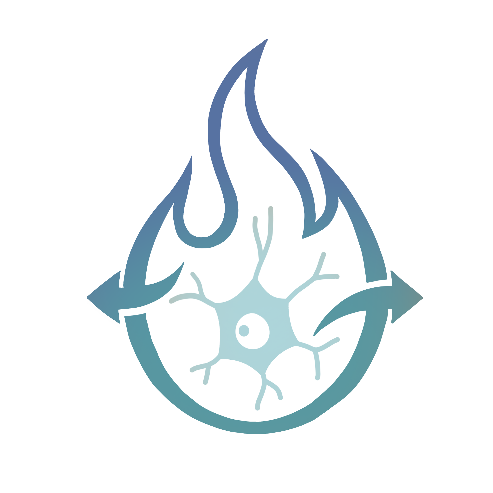

# CellMatchR



Segment cells in microscopy images, review predictions, and measure
colocalization. CellMatchR supports Cellpose-SAM, Micro-SAM, micro-SAM2, and StarDist.

**New here?** The [full user guide](docs/usage.md) has detailed setup
instructions, every workflow step, and answers to common questions.

## Install and launch

First, open a command window: **Terminal** on macOS (press **⌘ Space**, type
`Terminal`, press Return), **PowerShell** on Windows (search for it in Start),
or your Linux **Terminal** app. Type the commands below in that window, one
line at a time. **First, check whether Git is installed:**

```bash
git --version
```

If you see a version number, continue. If Git is not found,
[install Git](https://git-scm.com/downloads), reopen the command window, and
check again. Next, go to your Desktop using the line for your system.

**macOS or Linux:**

```bash
cd ~/Desktop
```

**Windows PowerShell:**

```powershell
cd ([Environment]::GetFolderPath('Desktop'))
```

The clone command below creates the app folder on your **Desktop by default**.
To put it somewhere else, replace the Desktop `cd` command above with the
path to an existing folder (for example, `cd ~/Documents` on macOS/Linux or
`cd "D:\Apps"` on Windows). Then clone CellMatchR and enter its folder:

```bash
git clone https://github.com/szhang99-bu/CellMatchR.git CellMatchR-app
cd CellMatchR-app
```

Cloning with Git allows later updates with `git pull`. **Code → Download ZIP**
also works, but it cannot use `git pull`; each upgrade requires another ZIP.
Already have the app folder? Open your command window **in that folder**
instead of cloning again. The [user guide](docs/usage.md#install-launch-and-update)
shows how to find it.

### Windows

1. Open the `CellMatchR-app` folder on your Desktop (or at the location you
   chose) and double-click **`setup-windows.cmd`**. This installs the app's
   own Conda-compatible environment; no separate Conda installation is needed.
2. Double-click **Launch CellMatchR (Windows)**, the shortcut with the logo.
   **`run-windows.cmd`** also launches the app.

### macOS

1. In **Terminal**, check for Conda by typing `conda --version`. A version
   number means it is installed. If Terminal says `command not found`, install
   [Miniforge for your Mac](https://github.com/conda-forge/miniforge#macos-pkg-installers),
   choose shell initialization during setup, then close and reopen Terminal.
   Run `conda --version` again.
2. Make sure Terminal is in the **CellMatchR-app folder**: `ls environment.yml`
   should print `environment.yml`. Then create the environment:

   ```bash
   conda env create -f environment.yml
   ```

   If the file is not found, type `cd ` (with a space), drag the app
   folder from Finder into Terminal, press Return, and retry.
3. Open `CellMatchR-app` on your Desktop (or at the location you chose) and
   double-click the app that matches your macOS version.
   - **macOS 27 or later** — `CellMatchR (macOS 27+).app`
   - **macOS 26 or earlier** — `CellMatchR (macOS 26 and earlier).app`

### Linux

1. In Terminal, run `conda --version`. If it is not found, install
   [Miniforge](https://github.com/conda-forge/miniforge#unix-like-platforms-macos-linux--wsl),
   reopen Terminal, and check again.
2. From the app folder (`ls environment.yml` should find the file),
   create the environment and add CellMatchR to your app menu:

   ```bash
   PIP_CONSTRAINT="$PWD/scripts/linux-pip-constraints.txt" \
     conda env create --prefix "$PWD/../CellMatchR-linux-env" --file environment.yml
   bash scripts/install_linux_launcher.sh
   ```

3. Open **CellMatchR (Linux)** from your app menu. For a terminal launch, run
   `bash run-linux.sh`.

## Upgrade CellMatchR

**Every upgrade has two parts: pull the new code, then update the app
environment.** `git pull` does not install new Python packages or update
existing ones. Do both parts even if you have updated CellMatchR before.

Close CellMatchR and let any running analysis or training finish. Open the
same Terminal or PowerShell app used for installation. Go to your **existing**
CellMatchR-app folder; do not clone a second copy. These commands use the
default Desktop location. If you installed elsewhere or your Desktop is stored
in a different location, use the actual path to your app folder. On macOS,
you can type `cd ` (with a space), drag that folder from Finder into Terminal,
and press Return.

**macOS or Linux Terminal:**

```bash
cd ~/Desktop/CellMatchR-app
git status --short
```

**Windows PowerShell:**

```powershell
cd (Join-Path ([Environment]::GetFolderPath('Desktop')) 'CellMatchR-app')
git status --short
```

If `git status --short` prints nothing, the app folder has no local changes.
If it lists files, [check the update guide](docs/usage.md#update-an-existing-git-installation)
before pulling so you can keep your work. **When the folder is ready**, run
this in the same window:

```bash
git pull --ff-only
```

**Next, refresh the environment using the updated setup files:**

- **Windows:** Double-click `setup-windows.cmd` in the updated app folder and
  wait for **Setup complete**. This also refreshes an existing Windows runtime.
- **macOS:** In Terminal, still in the app folder, run
  `conda env update -f environment.yml --prune`.
- **Linux:** In Terminal, still in the app folder, run:

  ```bash
  PIP_CONSTRAINT="$PWD/scripts/linux-pip-constraints.txt" \
    conda env update --prefix "${CELLMATCHR_LINUX_ENV:-$PWD/../CellMatchR-linux-env}" --file environment.yml --prune
  ```

  If your launcher uses a custom environment path, set `CELLMATCHR_LINUX_ENV`
  to that path before running the update.

Wait for the environment command to finish, then reopen CellMatchR. If it
fails, copy the full error from the run log; the last line alone may not show
the cause. Your projects and shared trained models remain in their own
folders. If you installed from a ZIP instead of cloning, download and extract
a new ZIP for each version, then refresh the environment as above; `git pull`
cannot update a ZIP copy.

## Run your first project

1. **Create a project** and choose an output folder.
2. **Select images.** Use **Confocal** to read images directly. Use **Slide scanner**
   to draw and name regions in a VSI, Leica slide-scanner LIF, TIFF, or BigTIFF.
3. **Segment** the channels you want to measure. Choose **micro-SAM2** to try
   the newer models. For Nissl, use **Brightfield stain** and start with
   `hvit_b_cells`. The first run downloads the selected model and sets up
   its separate environment. See the [model guide](docs/usage.md#step-3-segment-cells).
4. **Review** the predictions and run **Analysis** to generate object tables
   and a colocalization workbook.
5. **Retrain** in Step 7 if you want to fine-tune a model on corrected masks.

For detailed, step-by-step instructions, file formats, model choices, updating,
and troubleshooting, see the [user guide](docs/usage.md).

## Retrain a model

1. In **Step 4**, save your mask corrections: erase false predictions and draw
   missed cells. Individual cell verification is optional when training on all
   cells left in the corrected mask. Complete it if you want to train only
   selected cell labels such as YES or NO.
2. Open **Step 7: Retrain Models**. Choose the corrected run and one channel,
   the model family, starting weights, a name for the new model, and a training
   preset. Leave cell labels unselected to use all kept cells, or check multiple
   labels from completed cell reviews for a specialized model. You can add images
   from other projects and exclude images from this run.
3. Choose how to check the result. **Reserve one whole image** is recommended
   when you have at least two corrected images. Click **Start Retraining**, then
   compare the saved before/after report with the corrected masks.

The new model is saved separately in the shared CellMatchR model library and
can be selected for later training or segmentation in any project. See the
[detailed Step 7 guide](docs/usage.md#step-7-retrain-a-model) for every control,
advanced setting, validation choice, and result.
