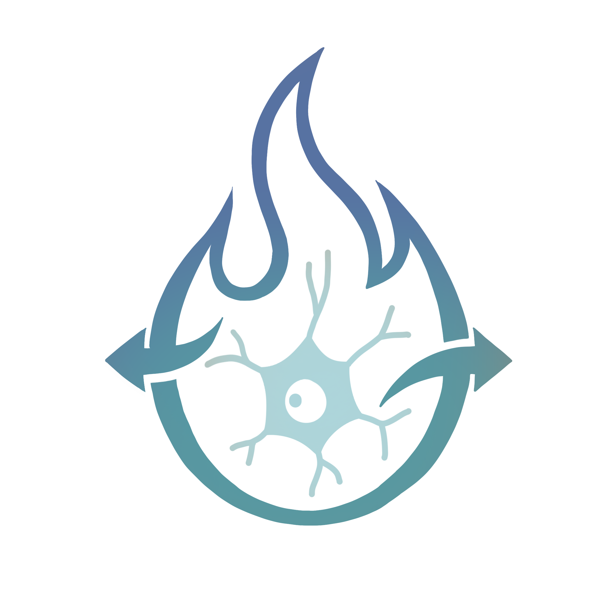

# CellMatchR



Neuronal confocal image segmentation, manual validation, and colocalization analysis pipeline.

Reads images directly from most major microscope brands — **Zeiss `.czi`**,
**Leica `.lif`**, **Nikon `.nd2`**, **Olympus FluoView `.oib` / `.oif`**, and
plain **`.tif` / `.tiff`** — plus **Olympus `.vsi`** slide-scanner files via the
built-in VSI Converter.  
Uses [Micro-SAM](https://github.com/computational-cell-analytics/micro-sam) (Segment Anything for microscopy) for automatic cell segmentation.

> **Not supported:** Olympus `.oir` (newer FV3000 format). Open it in
> [Fiji/ImageJ](https://imagej.net/software/fiji/) and export to `.tif` first.

---

## Pipeline overview

```
┌─────────────────────────────────────────────────────────────────┐
│  Step 1  — Create / Open Project                                │
│    • New project: choose an output folder, name it              │
│    • Open existing: select cellmatchr_project.json              │
├─────────────────────────────────────────────────────────────────┤
│  Step 2  — Input & Paths                                        │
│    • CZI/LIF/ND2/OIB-OIF/TIF → point to root input folder       │
│    • VSI        →  launch VSI Converter (draws ROIs,            │
│                    exports full-resolution TIFFs)               │
├─────────────────────────────────────────────────────────────────┤
│  Step 3  — Segmentation                                         │
│    • Tiled MicroSAM prediction on chosen channels               │
│    • Configurable model, preprocessing, size / shape filters    │
├─────────────────────────────────────────────────────────────────┤
│  Step 4  — Validation  (optional)                               │
│    • Name and colour each channel                               │
│    • Manual YES / NO / MAYBE / ARTIFACT review per cell ROI     │
│    • Results saved as TSV; ✔ shown only when all ROIs are done  │
├─────────────────────────────────────────────────────────────────┤
│  Step 5  — Analysis  (optional)                                 │
│    • IoU-based colocalization between two channels              │
│    • Per-ROI cell counts + colocalization percentages           │
│    • QC PNG overlays; combined summary saved to Analysis        │
└─────────────────────────────────────────────────────────────────┘
```

---

## Installation

### 1. Get the code

#### Option A — Download ZIP *(no git required, easiest for most users but difficult for later updates)*

1. Go to **https://github.com/szhang99-bu/CellMatchR**
2. Click the green **`<> Code`** button at the top of the page → **Download ZIP**
3. Unzip it to wherever you want to keep the software, e.g. your Desktop or Documents
4. Rename the unzipped folder from `CellMatchR-main` → `CellMatchR`

#### Option B — Clone with git

Replace the destination path with wherever you want to save it:

```bash
# macOS / Linux example — save to your Documents folder:
git clone https://github.com/szhang99-bu/CellMatchR.git ~/Documents/CellMatchR
cd ~/Documents/CellMatchR

# or save to the Desktop:
git clone https://github.com/szhang99-bu/CellMatchR.git ~/Desktop/CellMatchR
cd ~/Desktop/CellMatchR
```

### 2. Create the conda environment

The simplest way is to use the provided `environment.yml`, which specifies all
required packages with flexible version constraints (works on macOS arm64 and
Linux x86-64):

```bash
conda env create -f environment.yml
conda activate cellmatchr
```

> **GPU users:** The `environment.yml` installs a CPU-only PyTorch build.
> After creating the environment, upgrade to a GPU build following the
> [official PyTorch guide](https://pytorch.org/get-started/locally/) — e.g.
> for CUDA 12.1:
> ```bash
> conda activate cellmatchr
> pip install torch torchvision --index-url https://download.pytorch.org/whl/cu121
> ```

### 3. Install CellMatchR itself

```bash
pip install -e .
```

---

## Updating an existing install (other computers)

If a computer already has a working `cellmatchr` environment from an earlier
version, you only need to (1) get the new code and (2) add the new microscope
readers — **you do not need to rebuild the conda environment.**

```bash
# 1. Get the latest code
cd /path/to/CellMatchR
git pull                      # (or re-download the ZIP and replace the folder)

# 2. Add the new file-format readers into the existing env.
#    --no-deps is IMPORTANT: it adds only these packages and will NOT touch
#    numpy or anything else already installed.
conda activate cellmatchr
pip install --no-deps "readlif==0.6.5" "nd2==0.11.3" "oiffile==2026.2.8"
```

> ⚠️ Use the exact versions above. In particular **do not** let `readlif`
> install 0.6.6 — that version requires `numpy>=2`, which would break the
> segmentation stack (this env must stay on `numpy 1.26.x`). The `--no-deps`
> flag prevents that.

**About the macOS app:** `CellMatchR.app` ships with the code, so a `git pull`
updates it automatically. If you got the code as a **ZIP** (which can drop the
executable bit), re-arm the launcher once after unzipping:

```bash
chmod +x "CellMatchR.app/Contents/MacOS/CellMatchR"
```

---

## Launching CellMatchR

### Option A — double-click the app (macOS, recommended)

Double-click **`CellMatchR.app`** in Finder. It opens the CellMatchR window
**with no Terminal window**, finds your conda installation, and runs the wizard.

**First launch (one time):** macOS Gatekeeper blocks unsigned apps, so the first
time **right-click the app → Open → Open** to approve it. After that, a normal
double-click works.

**Important — keep the app in the project folder:**

- `CellMatchR.app` must stay **inside the CellMatchR folder** (at the project
  root); it locates the code relative to its own position.
- To launch it from the **Dock or Applications**, do **not** move it — instead
  make an **alias** (right-click → **Make Alias**) and put the *alias* there, or
  drag the app to the Dock while holding **⌥⌘** (which creates a Dock alias).
  An alias remembers the original location, so the app still finds the code.
- If the app is ever moved out of the folder, it shows an alert explaining this
  instead of failing silently.

> Got the code as a ZIP? Run `chmod +x "CellMatchR.app/Contents/MacOS/CellMatchR"`
> once (see *Updating an existing install* above) — ZIP downloads can strip the
> executable bit.

### Option B — double-click the `.command` (macOS, shows a Terminal/log window)

Double-click **`scripts/launch_cellmatchr.command`** in Finder (first time:
right-click → **Open**). This does the same thing as the app but keeps a Terminal
window open showing the live log — handy for debugging. Keep it inside the
`scripts/` folder.

### Option C — terminal

```bash
conda activate cellmatchr
python scripts/run_cellmatchr.py
```

### Option D — entry-point (after `pip install -e .`)

```bash
conda activate cellmatchr
cellmatchr
```

---

## Project files

When you create or save a project, CellMatchR writes a
`cellmatchr_project.json` into the project output folder.  
To re-open the project later, go to **Step 1 → Open Existing Project** and
click **Browse…** to select that `.json` file.

Settings are also cached in `~/.cellmatchr/config.json` and restored
automatically on the next launch.

---

## Project output structure

```
<project_output_folder>/
├── cellmatchr_project.json          # saved project settings
├── VSI_Converted_TIFF/              # (VSI only) exported full-res TIFFs
├── Segmentation/                    # MicroSAM prediction masks + QC images
│   └── <sample_name>/
│       ├── *_predict_original_*.tif
│       ├── *_split_ch*.tif
│       └── ROI Validation Results/
│           ├── roi_verification_results.tsv
│           └── _validation_complete   (written when all ROIs are reviewed)
└── Analysis/                        # colocalization results
    ├── combined_analysis_summary.csv
    ├── combined_analysis_summary.xlsx
    └── <sample_name>/
        └── analysis_results/
            ├── *_summary.csv
            ├── *_cell_of_interest_object_table.csv
            └── *_QC_overlay.tif
```

---

## Repository structure

```
CellMatchr/
├── CellMatchR.app/                # macOS double-click launcher (no Terminal)
├── CellMatchr_Logo.png            # application logo
├── README.md
├── environment.yml                # conda environment (flexible versions)
├── pyproject.toml
├── requirements.txt
├── scripts/
│   ├── run_cellmatchr.py          # CLI entry point  (python scripts/run_cellmatchr.py)
│   └── launch_cellmatchr.command  # macOS launcher with a Terminal/log window
└── cellmatchr/
    ├── __init__.py
    ├── config.py                  # config load/save (~/.cellmatchr/config.json)
    ├── launcher.py                # tkinter step-by-step wizard
    ├── vsi_converter.py           # VSI → TIF converter (napari / Qt)
    ├── segmentation.py            # MicroSAM tiled segmentation
    ├── validator.py               # manual ROI validation UI
    └── analysis.py                # IoU colocalization analysis
```

---

## Running individual scripts

Each tool can be run standalone with `--config` to override the config path:

```bash
python -m cellmatchr.vsi_converter   --config /path/to/config.json
python -m cellmatchr.segmentation    --config /path/to/config.json
python -m cellmatchr.validator       --config /path/to/config.json
python -m cellmatchr.analysis        --config /path/to/config.json
```
