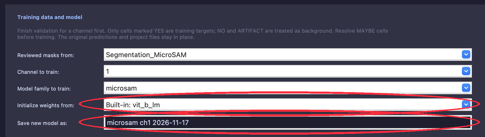
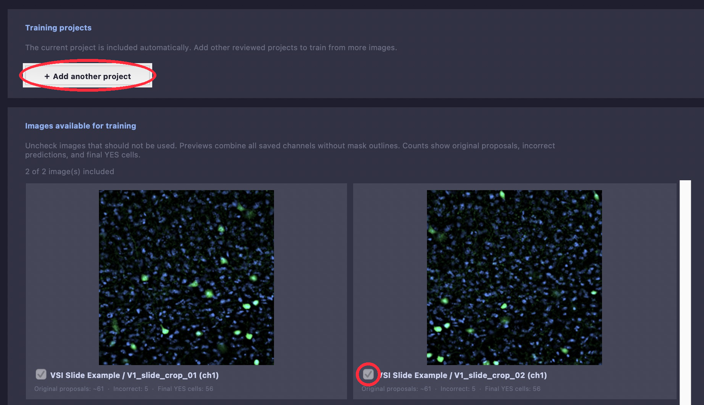
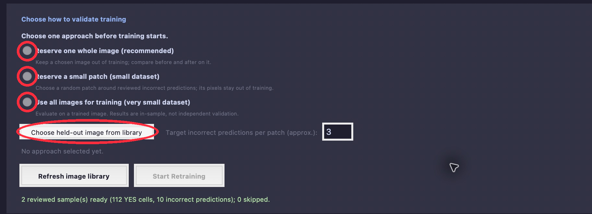

# CellMatchR user guide

CellMatchR turns microscopy images into cell masks, lets you correct and review
them, produces measurements, and can fine-tune models from reviewed examples.
The [README](../README.md) is the short installation guide; this page explains
the full workflow and answers common questions.

## Contents

- [Install, launch, and update](#install-launch-and-update)
  - [Update a Git installation](#update-an-existing-git-installation)
  - [Update a ZIP installation](#update-a-zip-installation)
- [Choose the right input](#choose-the-right-input)
- [Step 1: Create or open a project](#step-1-create-or-open-a-project)
- [Step 2: Select images and regions](#step-2-select-images-and-regions)
- [Step 3: Segment cells](#step-3-segment-cells)
- [Step 4: Correct and validate predictions](#step-4-correct-and-validate-predictions)
- [Step 5: Analyze results](#step-5-analyze-results)
- [Step 6: Retrain a model](#step-6-retrain-a-model)
- [Large Batch Processing](#large-batch-processing)
- [Understand files and outputs](#understand-files-and-outputs)
- [Frequently asked questions](#frequently-asked-questions)
- [Troubleshooting by symptom](#troubleshooting-by-symptom)
- [Command-line reference](#command-line-reference)

## Install, launch, and update

### Where to type the commands

| Computer | Open a command window |
|---|---|
| macOS | Press **⌘ Space**, type **Terminal**, then press Return. |
| Windows | Open **Start**, type **PowerShell**, and open it. |
| Linux | Open the **Terminal** app from your applications menu. |

Type each line in a code block into that window and press Return or Enter.
The command window shows where you are and prints results or errors. You do
not type the word `bash` above a code block.

### Get an updateable copy of CellMatchR

The first command to run in your command window is:

```bash
git --version
```

If it prints a version number, Git is ready. If Git is not found,
[install Git](https://git-scm.com/downloads), reopen the command window, and
run `git --version` again. Then move to your Desktop using the command for
your system:

**macOS or Linux Terminal:**

```bash
cd ~/Desktop
```

**Windows PowerShell:**

```powershell
cd ([Environment]::GetFolderPath('Desktop'))
```

The Windows command finds your actual Desktop location, including a Desktop
redirected to OneDrive. If `cd ~/Desktop` says the folder does not exist on
Linux, open your Desktop in the file manager and choose **Open in Terminal**
there.

The clone command below creates the app folder on your **Desktop by default**.
To put it somewhere else, replace the Desktop `cd` command above with the
path to an existing folder. For example, use `cd ~/Documents` on macOS/Linux
or `cd "D:\Apps"` in Windows PowerShell. Keep quotes around a path that
contains spaces. Now clone the repository and enter its folder:

```bash
git clone https://github.com/szhang99-bu/CellMatchR.git CellMatchR-app
cd CellMatchR-app
```

`git clone` creates **CellMatchR-app** on your Desktop by default, or in the
other folder you chose; the last `cd` enters it. You can open that folder in
Finder or File Explorer. The app folder has a different location from the
shared model library at `~/CellMatchR/Models`, so trained models stay outside the Git
checkout. Cloning retains Git history, allowing later updates with `git pull`.

**Already have an app folder?** Do not clone it again. Open a command
window and enter that existing folder instead:

- **macOS:** Type `cd ` including the space, drag the CellMatchR app folder from
  Finder onto the Terminal window, then press Return. Finder inserts its full
  path, including spaces in folder names.
- **Windows:** Open the CellMatchR app folder in File Explorer. Click the address
  bar, type `powershell`, and press Enter. PowerShell opens in that folder.
- **Linux:** Use your file manager's **Open in Terminal** option for the
  app folder, or run `cd /full/path/to/CellMatchR-app` in Terminal.

To confirm you are in the right folder, type `pwd`, then `ls environment.yml`.
The first command prints your current location; the second should list the
`environment.yml` file. If you see *file not found*, enter the CellMatchR
app folder and try again. Run environment commands only after this check.

**Code → Download ZIP** works if Git is unavailable, but a ZIP cannot use
`git pull`. Extract the ZIP before setup and keep project outputs outside the
app folder. [Update a ZIP installation](#update-a-zip-installation)

### Windows setup

Use 64-bit Windows on an x64 Intel or AMD processor. Setup was verified on
Windows 11. It downloads and installs the app's micromamba and Python
environment.

1. Open the `CellMatchR-app` folder on your Desktop (or at the location you
   chose) in File Explorer.
2. Double-click `setup-windows.cmd` and wait for **Setup complete**. Setup
   creates the runtime at `%SystemDrive%\CellMatchR` (usually `C:\CellMatchR`)
   and puts the launcher shortcut inside the app folder.
3. In the app folder, double-click **Launch CellMatchR (Windows)**. You can
   also double-click `run-windows.cmd`.

Setup records the runtime, environment, and package cache paths in
`setup-paths.txt` inside the runtime folder. For a custom runtime in a
deeply nested folder, setup tries a shorter private cache to prevent
package extraction errors.

If you chose a custom runtime, set the same absolute folder path in PowerShell
before running `.\setup-windows.cmd` or `.\run-windows.cmd`:

```powershell
$env:CELLMATCHR_WINDOWS_RUNTIME = 'D:\CellMatchR-runtime'
```

Replace the example path with the one you used at setup. If you installed in
CPU-only mode, repeat `.\setup-windows.cmd -Device CPU` on upgrades.

### macOS setup

1. In **Terminal**, type `conda --version`. A version number means Conda is
   available. Existing Miniforge, Miniconda, or Anaconda installations can be
   used if this command works. If it says `command not found`, check whether
   you already installed Conda but have not initialized it for Terminal; see
   your Conda installer's shell setup instructions before installing a second
   copy.
2. If Conda is absent, install [Miniforge's macOS package](https://github.com/conda-forge/miniforge#macos-pkg-installers).
   In **Apple menu → About This Mac**, check whether the chip is Apple Silicon
   or Intel and choose the corresponding `.pkg`. During installation, select
   shell initialization. Close Terminal, open it again, and check
   `conda --version` once more. Continue only when it prints a version.
3. Enter the app folder if needed, then type `ls environment.yml` to
   confirm you are beside the file. Create the app environment:

   ```bash
   conda env create -f environment.yml
   ```

   This creates an environment named `cellmatchr`. If you have already set it
   up, `conda env list` shows it; you can skip creating it again. To update an
   existing environment after a code update, use the command below under
   [Update an existing Git installation](#update-an-existing-git-installation).
4. Open `CellMatchR-app` on your Desktop (or at the location you chose) in
   Finder. Use `CellMatchR (macOS 27+).app` on macOS 27 and later, or
   `CellMatchR (macOS 26 and earlier).app` on macOS 26 and earlier. If macOS
   asks for Desktop access, click **Allow** when your app or project is
   stored there. Keep the `.app` inside the app folder because it runs
   the code stored there.

On an Intel Mac, choose Micro-SAM or Cellpose-SAM for segmentation.
micro-SAM2's separate macOS environment requires a PyTorch wheel that is
published for Apple Silicon. [PyTorch release files](https://pypi.org/project/torch/2.10.0/#files)

### Linux setup

1. In Terminal, type `conda --version`. If it prints a version, continue. If
   Conda is absent, follow the [Miniforge Linux installation instructions](https://github.com/conda-forge/miniforge#unix-like-platforms-macos-linux--wsl),
   choose shell initialization, reopen Terminal, then check
   `conda --version` again.
2. In Bash, enter the app folder and confirm `ls environment.yml` finds the
   file. Run both commands below. The environment is created alongside the
   app folder.

   ```bash
   PIP_CONSTRAINT="$PWD/scripts/linux-pip-constraints.txt" \
     conda env create --prefix "$PWD/../CellMatchR-linux-env" --file environment.yml &&
     bash scripts/install_linux_launcher.sh
   ```

3. Open **CellMatchR (Linux)** from the applications menu, or run
   `bash run-linux.sh` from the app folder to see a terminal log.

### Update an existing Git installation

Let analysis and training finish, then close CellMatchR. In the existing app
folder, run `git status --short --branch`. The standard release is on
`main`. Lines below the branch name list local changes or new files. Review
those files and save any work you need to keep before updating. If you
previously checked out a testing branch, run `git switch main` once your
work is saved. Then run `git pull --ff-only`.

After pulling, refresh the app environment to install the required Python
packages. Rerun `setup-windows.cmd` on Windows with your
[original runtime settings](#windows-setup). On macOS, run
`conda env update --name cellmatchr --file environment.yml --prune`.
On Linux, run the following in Bash.

```bash
PIP_CONSTRAINT="$PWD/scripts/linux-pip-constraints.txt" \
  conda env update --prefix "${CELLMATCHR_LINUX_ENV:-$PWD/../CellMatchR-linux-env}" --file environment.yml --prune
```

If you installed the Linux environment in a custom location, set
`CELLMATCHR_LINUX_ENV` to the same path your launcher uses before updating.
To check the dependencies in that environment, run:

```bash
linux_env="${CELLMATCHR_LINUX_ENV:-$PWD/../CellMatchR-linux-env}"
"$linux_env/bin/python" -c 'from importlib.metadata import version; print({p: version(p) for p in ("micro-sam", "torch-em", "zarr", "tifffile")})'
```

This version of CellMatchR expects Micro-SAM 1.7.0 and torch_em 0.8.1.
Tiled or compressed TIFF slides require Zarr 3. Compare the printed versions
with the pins in `environment.yml` if model checksums or TIFF reads fail.

If you moved the checkout, recreate the Windows shortcut with
`.\setup-windows.cmd -ShortcutOnly` from PowerShell, or rerun
`bash scripts/install_linux_launcher.sh` on Linux.

### Update a ZIP installation

Download the latest ZIP and extract it into a fresh folder beside your old
app folder. Keep the old folder until you have moved any project data it
contains. From the new app folder, follow the environment update commands
above for your operating system. On Linux, run
`bash scripts/install_linux_launcher.sh` from the new app folder to update
the applications menu entry. Open the launcher in the new folder on macOS
or Windows.

## Choose the right input

Choose the acquisition type in **Step 2 → Input & Paths**. The two modes can
both encounter a `.lif` file; the file extension alone does not identify the
acquisition. CellMatchR checks its contents and skips a LIF in the wrong mode.

| Data | Mode | What happens |
|---|---|---|
| Zeiss `.czi` | **Confocal** | Read directly, one acquisition per sample. |
| Leica confocal `.lif` | **Confocal** | Read directly; stitched slide-scanner LIFs are skipped here. |
| `.tif` / `.tiff` microscopy images | **Confocal** | Read directly. |
| Nikon `.nd2`, Olympus `.oib` / `.oif` | **Confocal** | Available as beta readers; check a test image first. |
| Olympus slide-scanner `.vsi` | **Slide scanner** | Draw and export named, full-resolution regions. Keep its companion folder beside the VSI. |
| Stitched Leica slide-scanner `.lif` | **Slide scanner** | Draw and export regions; confocal LIFs are skipped here. |
| Large TIFF or BigTIFF slide | **Slide scanner** | Draw and export regions, including from an already converted scan. |
| Olympus `.oir` | Neither | Convert to TIFF in Fiji/ImageJ or another reader before using CellMatchR. |

For a VSI named `sample.vsi`, preserve the matching `_sample_` companion folder
next to it. Missing companion data can prevent the converter from opening the
scan. Keep the original acquisition files until you have checked exported
crops and masks.

TIFF previews use a stored image pyramid when available. For TIFFs with
explicit time and Z axes, the preview uses the first time point and a maximum
intensity projection through Z. Some tiled, compressed TIFFs need Zarr 3 in
the CellMatchR environment. The **Confocal** input browser can scan files
directly in the chosen root or one level of subfolders; **Skip subfolders** in
Step 3 limits the run to files directly in the root.

For slide scans, select **Laser fluorescence** when cells are bright labeled
signals, or **Brightfield stain** for dark stained cells such as Nissl. The
brightfield option adapts model input and the Parameter Wizard internally;
the image you see stays at its original stain brightness. Brightfield is
treated as one combined cell signal, **channel 0**. Color crops are exported
as RGB TIFFs, retaining the original colors for previews and compatible models.

## Step 1: Create or open a project

1. Choose **New Project**, enter a name, and select a project output folder.
2. Click **Create Project Folder**. CellMatchR creates
   `cellmatchr_project.json` and output subfolders there.
3. For an existing project, choose **Open Existing Project** and select its
   `cellmatchr_project.json` file. Click **Load Project Settings** to enable
   **Next**. Confirm the restored input and selected run before processing.

The project file stores paths and settings; masks, tables, and crops live in
the project output folder. You can open an earlier project with the current
app. CellMatchR restores the saved input type and slide signal. If a project
has moved, it reconnects project-local crops and ROI masks using the folder
that contains the selected project file. External raw image paths may still
need to be selected again in Step 2.

## Step 2: Select images and regions

### Confocal or direct-read images

Select **Confocal**, browse to the input root, and click **Confirm Input
Folder**. A common layout is one acquisition per subfolder:

```text
input-root/
  sample-01/sample-01.czi
  sample-02/sample-02.czi
```

Inspect the file list before proceeding. If a `.lif` is marked as a
slide-scanner acquisition, choose **Slide scanner** for that file instead.
You can also use TIFF files as direct input.

### Slide-scanner images

1. Select **Slide scanner**, then **Laser fluorescence** or **Brightfield
   stain**.
2. Click **Launch Slide Scanner Converter** and choose the VSI, stitched LIF,
   or TIFF slide.
3. Draw and name the regions you need. Save and export them as full-resolution
   TIFF crops and matching region masks.
4. After closing the ROI editor, review the saved ROIs in the converter
   window. Choose **Select another image** to process another slide, or
   **Done — return to CellMatchR** to continue to Step 3. The exported TIFF
   folder is selected automatically.

The normal export location is `VSI_Converted_TIFF/` inside the project. If you
convert the same or another scan later, inspect the output choice: existing
exports can be replaced or kept in a numbered folder. Step 3 lets you choose
among multiple converted outputs. The optional output and input folder
overrides in Step 2 are for data already stored elsewhere.

## Step 3: Segment cells

### Select channels and a model

Click **Load Preview** to inspect channels; click the preview to toggle a
channel for prediction. You can also type zero-based IDs in **Channels to
predict**, separated by commas, such as `0,2`. For brightfield slide scans,
use `0` because the RGB stain is combined into one cell signal.

| Backend | Models shown in the app | Use it when |
|---|---|---|
| **Micro-SAM** | Built-in model types such as `vit_b_lm`, plus saved models | You want SAM-based masks or have a compatible fine-tuned checkpoint. |
| **micro-SAM2** | `hvit_t_cells`, `hvit_s_cells`, `hvit_b_cells` (default), `hvit_l_cells` | Try Base first for Nissl brightfield, or Tiny for a smaller model. |
| **Cellpose** | Cellpose-SAM (`cpsam`), Cellpose 2 (`cyto2`), Rat Nissl v2, plus saved models | You want Cellpose behavior or to compare its Nissl-specific option. |
| **StarDist 2D** | Built-in `2D_versatile_fluo`, plus saved models | Cells are reasonably star-convex. First use sets up StarDist and fetches its weights if needed. |

Select the **Segmentation backend** and then choose the **Model type** or
**Model for this run** shown for that backend. Saved
models in the shared library appear in the dropdown; an external checkpoint
can be browsed separately. Cellpose 2 and Rat Nissl v2 use a separate legacy
runtime, which is prepared on first use. Rat Nissl v2 came from juvenile rat
cresyl-violet images; test it on your own tissue before relying on it.
Changing backend or model does not delete other segmentation runs.

### Compare models on a patch

Open **Model Selection Wizard** in Step 3. Choose the channel you plan to
segment and click the first image to place a square. The second panel
previews the selected patch at a larger scale. Use **1,024 pixels** to include
more cells, or select **768** or **512** for a smaller area. Pick a patch
that includes dim cells or uneven background as well as obvious cells.

Click **Compare models** to run Micro-SAM, micro-SAM2, Cellpose-SAM and
StarDist on the same patch. You can remove a model or add another built-in
or saved model before starting. The progress bar advances as each model
finishes. The status line shows when a backend is being set up, when it is
downloading weights, and when it starts predicting. If a model fails, use
**View log** on its card. Other previews can still finish.

The first panel shows the source patch. The other panels show proposed
masks before size, shape and intensity filters. Click the source panel to
zoom every preview to the same location. Look for visible cells the model
missed, then check for excess masks. Click the prediction you prefer. A green
outline marks your choice. Click **Use selected model** at the bottom to apply
the model and the tested settings. The comparison closes and returns you to
Step 3 once the preview is saved.

Use **Parameter Wizard** in Step 3 to set filters from the same patch.
It reuses the prediction while the input and model settings match. If you configured
multiple channels, it computes fresh masks only for the other channels.
Without a matching preview, it uses the first image as usual.

Starting a full segmentation run after choosing a model saves the source
patch, prediction images, masks and model settings under the project's
`Model_Wizard_Previews/<segmentation run>` folder. When you reopen the
project, **Model Selection Wizard** opens the saved comparison. Choose
**Change patch or models** to run a new comparison. The **Parameter
Wizard** can also reuse the saved mask after a restart.

### Additional Pretrained Model Downloads

Open **Additional Pretrained Model Downloads** beside **Segmentation backend**
in Step 3 or from the Model Selection Wizard. Use it to prepare a model ahead
of time. The Model Selection Wizard and segmentation can also download the
weights they need on first use.

1. Choose a model in the dropdown. It lists models that still need weights
   and their approximate download sizes. The **Downloaded models** list shows
   models whose weights are already cached on this computer.
2. Click **Download selected model**. The status and log show what the app is
   doing. First use can also install the backend runtime. A micro-SAM2
   microscopy model downloads its encoder and decoder separately, so the
   status identifies the current file. Slow transfers can switch to parallel
   connections and keep the bytes already received.
3. Once complete, the model moves into **Downloaded models**. The Model
   Selection Wizard and Step 3 share the same model cache across projects.
   Choose the model in Step 3, or add it to a wizard comparison.

If the Micro-SAM host is unavailable, select the pending model and use
**Import Micro-SAM weights** to add the original checkpoint and decoder from
another computer. CellMatchR checks both files against the published
checksums before adding them to the cache.

### Run micro-SAM2

For Nissl, choose **Slide scanner → Brightfield stain** in Step 2, then
choose **micro-SAM2 → hvit_b_cells** in Step 3. Use channel **0**. The model
receives the original RGB pixels and applies its own normalization.
Grayscale brightfield TIFFs use their original single channel. For
fluorescence, each selected channel is segmented separately using its
original intensity values. The **Preprocessing mode** box shows the input
used by micro-SAM2. The **Parameter Wizard** uses the same model input and
measures brightness in the saved channel.

Starting the first run or opening the Parameter Wizard prepares a separate
Python environment and downloads the chosen weights. Allow that step to
finish with an internet connection. The runtime and built-in model cache live
in `~/CellMatchR/MicroSAM2` and are reused across projects. Saved fine-tuned
Micro-SAM models are still selected under **Micro-SAM**. Corrected micro-SAM2
masks can be used in Step 6 to train the existing model families.

Use a new output run when comparing the two versions. On a small comparison of
published 20× Nissl fields, micro-SAM2 Base found more annotated objects with
original RGB than either model using inverted grayscale. Results can vary
with stain, tissue and scanner. Use **Test run** to inspect a representative
image before running the batch.

### Adjust sensitivity and filtering

Start with a **Test run** on the first file. For Cellpose, the main controls
are:

| Control | Starting value | If real cells are missed | If background is detected |
|---|---:|---|---|
| Cell diameter | `0` (automatic) | Set an appropriate typical diameter if scale looks wrong. | Check whether the size matches the cells. |
| Cell-probability threshold | `0.0` | Lower it to allow dimmer cells; expect more false positives. | Raise it for stricter detections. |
| Flow threshold | `0.4` | Raise it to retain more irregular masks. | Lower it to reject more poorly shaped masks. |

**Object Filtering** applies after prediction. A filter value of `0` disables
that filter. Available bounds cover minimum and maximum object area in pixels,
maximum major/minor axis ratio, and raw signal. Fluorescence uses a **minimum
mean raw intensity**; brightfield uses a **maximum mean raw brightness** so
darker stained cells can be kept. Per-channel filter overrides are available
for fluorescence. Be careful with strict filters: an object removed here will
not appear for later validation or analysis.

The **Parameter Wizard** segments the first sample without object filters,
then lets you pick example cells to derive size, shape, and signal thresholds.
For brightfield it shows the original stain brightness. You can leave a bound
unset to keep that filter off when you make a selection. Closing the wizard
without picking an object keeps your existing filters. Use a representative
image and inspect its results before processing a full batch.

**Preprocessing mode** changes model input. For brightfield, inversion is
handled in the backend as needed; the visible image is not inverted. **Tiling**
controls tile height, width, overlap halo, and QC overlay downsampling. Smaller
tiles may help memory-limited machines but can change boundary behavior; test
an image before a large run.

### Run and compare

Click **Run Segmentation**. **Test run** processes only the first file and
saves per-tile debug PNGs. If an interrupted run is detected, **Continue a
previous run** appears and skips completed files. New runs can be kept in
separate, named or numbered segmentation folders. In Steps 4 and 5, select
the exact run you want to review or analyze, especially when comparing
models. Each run's settings are shown beside its selector.

## Step 4: Correct and validate predictions

Step 4 is optional for basic analysis. Choose the **Channel to Validate** at
the top. **Load Preview** shows that channel in the first input image. Use
the arrows to browse other channels for reference. If you have multiple
segmentation runs, choose the one you want to review in the same panel. The
preview uses the same controls as Step 3. You can do Bulk Review, Individual
Object Review, or both. Analysis uses saved corrections and review decisions
from the run you analyze.

### Bulk Review

Click **Review Segmented Images** to open whole images in Napari. This is a
quick way to paint in missed cells and remove obvious false detections. Small
errors can remain after a whole-image pass.

For brightfield slides, the editor shows the original stain colors from the
matching TIFF. The prediction masks and drawn ROI stay aligned with that
image. If the color TIFF is unavailable or the source is grayscale, the
editor uses the saved grayscale channel.

| Task | Action |
|---|---|
| Add a missed cell | Click the large **ADD MISSED CELLS** button on the right and paint it. Each disconnected painted area becomes a separate object. For touching cells, use different label colors. |
| Remove a false prediction | Click the large red **REMOVE PREDICTED OBJECTS** button on the right, then brush over any part of the prediction. The whole object disappears from the preview and is removed from the active mask when saved. |
| Hide or show predicted ROIs | Press **H** to toggle the **Existing ROIs** layer. Your current brush marks stay visible. |
| Undo a stroke | Press **Ctrl+Z** before saving. |
| Paint or navigate | Press **P** for paint mode; right-drag to pan; use `[` and `]` to change brush size. |
| Save changes | Click **Save & Next** to move forward, **Skip** to leave the current image untouched, or **Previous** to go back. **Finish** becomes available on the last image. |

On a Mac using an iPad as a Sidecar display, Apple Pencil draws or erases, one
finger pans, two fingers pinch to zoom, and Pencil double-tap switches tools.
This behavior is enabled
only for Sidecar; normal Napari mouse controls remain available. **Test mode**
in Step 4 processes one image and saves to a `DEBUG_` file so you can inspect
the result before changing production masks. Napari's ordinary eraser on the
**Add ROIs here** layer reshapes an unsaved addition; use the red removal
button to reject an original model prediction. On the first normal save, the
editor keeps an untouched copy of the prediction beside the active mask.
The active mask is updated so existing analysis and older app versions still
read the corrected cells. Added objects are listed in
`_manual_additions_chN.tsv`; removed model predictions are listed with reason
`ARTIFACT` in `_manual_deletions_chN.tsv`. Those records let retraining tell
missed cells from incorrect predictions. A project edited before this feature
cannot recover an original prediction that was already overwritten; its next
edit preserves the mask as it exists then. Editing a mask after validation
may flag only affected objects for revalidation; check the validation status
before analysis or retraining.

### Individual Object Review

Complete **Bulk Review** and save your corrections first. Then click **Review
Individual Objects** to check each detection in the corrected masks and save a
decision. This takes longer and gives you finer control over which objects to
keep and how to label them. Open **Channel names and colors…** to customize the
display, including reference channels you did not segment. Use **Refresh** to
update the progress list after closing the review window.
Hold **Z** to hide the ROI outlines in every view. Release **Z** to restore
the previous visibility. In the Notes box, **Z** types normally.

The default keys are **Left = YES**, **Right = NO**, **Up = MAYBE**,
**Shift = ARTIFACT**, and **Down = Save & Next**. Use **Edit decision buttons**
on the right to customize up to six options. Enter the decision word, click
its key button, then press the shortcut. Shift, Down, and Z are reserved. If
an existing decision used Z, you can click the decision button or assign a new
shortcut. Use notes and **Go Back** if you need to revise an earlier object.
Decisions save as TSV files alongside the prediction files.

For training, **YES** and **NO** are both cell labels and are targets by
default. **ARTIFACT** alone marks an incorrect prediction; **MAYBE** must be
resolved. You can choose one or several cell labels in Step 6 for a specialized
model. If the goal is high recall, add genuinely
missed cells in the mask editor rather than trying to label them in a list of
existing predictions: a missing prediction has no object to validate.
For an older project where **NO** was used to mean an incorrect prediction,
review those decisions before retraining. Mark incorrect objects ARTIFACT, or
select only the cell labels you want as training targets. Existing analysis
and segmentation outputs are not changed by retraining.

## Step 5: Analyze results

### Input

Choose the **Segmentation run**. Step 4 shares this selection, so check it
after switching between models. For whole-image measurements on directly read
images, leave the **ROI mask folder** blank. For measurements inside regions,
use full-size `.tif` or `.tiff` masks or Fiji `.roi` files with matching image
names. For converted slide scans, CellMatchR selects masks from the converter
run that produced the crops by default.

Open **ROI options** to set the **Cell inclusion rule**. `centroid` counts a
cell whose center is inside the ROI. `any_pixel` counts a cell that touches
the ROI. Select **Review ROI mask matches** to check or revisit the matches.
If an older mask name needs confirmation, use **Choose an ROI mask**.
**Whole image only** and missing masks leave the ROI columns blank and keep
the whole-image measurements.

### Measurements

Choose the **Channel to measure**. For colocalization, turn on **Compare with
another channel (colocalization)**, choose a **Protein marker channel**, and
set **Minimum overlap (IoU)** from `0` to `1`. The comparison uses two distinct
segmented channels. Brightfield uses **Channel 0** and automatically runs as
single-channel analysis.

Open **Review status** to check progress for the channels you selected.
Analysis reads the masks with any saved Bulk Review edits. It applies saved
individual decisions from both complete and partial reviews, and skips
decisions that need re-review. **ARTIFACT** removes a
detection from the analysis. **YES** and **NO** are cell labels. An image with
no individual decisions is measured from its active mask alone. Check the
validation status in the output when comparing fully and partially reviewed
images. An incomplete review from an older project may need confirmation if
its decisions have no channel assignment and the image has multiple predicted
channels.

### Run Analysis

Open **Output options** to change the per-image analysis subfolder name or
turn QC overlay images on or off. Click **Run Analysis** to write per-image
object CSV tables and `combined_analysis_summary.xlsx`. The workbook includes
counts, object size, intensity, and configured colocalization summaries. An
image missing a selected channel is skipped and its summary row identifies the
missing channel. The completion line reports how many images were analyzed,
skipped for missing channels, and failed. The **Analysis log** stays visible
below the run controls and shows progress and messages.
`analysis_errors.log` in the analysis output folder has file-specific details.

If results already exist for that run, CellMatchR asks **Replace analysis
results?**. **No** cancels and preserves them. **Yes** backs up that run's
previous generated results under `.analysis_backups/` in the project, then
runs the analysis. Other segmentation runs are not replaced. When reopening
a project after an interrupted replacement, the app checks unfinished backups
and attempts recovery.

## Step 6: Retrain a model

Use masks saved after correction in Step 4, or masks with completed individual
cell verification. Choose the segmentation run, one channel, the model family
to train, a starting model, and a **new model name**. If you leave cell labels
unselected, all cells left in a saved corrected mask become training targets;
erased predictions and cells explicitly marked ARTIFACT become background.
You do not need to verify every cell individually for this default mode. To
train only YES, NO, or other selected labels, complete individual cell
verification first. Resolve any explicitly marked MAYBE objects before training.
The masks can
have been created with **any** model family. For example, reviewed Micro-SAM
masks can teach a Cellpose model.

**Initialize weights from** selects the starting model *within* the model
family being trained. It is not a save location and does not determine which
reviewed masks are used. Choose a built-in model or a saved fine-tuned model in
the dropdown. **Show advanced settings** contains an option to browse for an
external checkpoint. The named result is saved separately in the shared
library at `~/CellMatchR/Models`; it does not replace the built-in or earlier
model. You can select it for a later training round or in Step 3 for any
project. **Select the new model for this project's next segmentation runs**
also makes it the current choice after training.



*The red circles mark the starting weights and the name of the separate new model.*

### What each model and data control does

| Control | What to choose and what happens |
|---|---|
| **Masks to train from** | Select the current project's segmentation run whose masks you corrected in Step 4 or verified cell by cell. This supplies training targets; it does not choose the model whose weights will be changed. |
| **Channel to train** | Choose one channel found in that run. Step 6 trains one channel at a time; train channels 0, 1, and 2 separately if you need all three. The menu updates when the reviewed run changes. |
| **Cell labels to train** | Leave every box unchecked (the default) to use **all cells kept in a saved corrected mask**; individual cell verification is optional. Check one or more labels after completing cell-by-cell review to make only those cells training targets. Other valid cell types become background in this specialized model, so it may stop detecting them. Erased predictions and ARTIFACT remain background and cannot be selected as cell labels. |
| **Model family to train** | Pick **Micro-SAM**, **Cellpose**, or **StarDist**. This controls the training software, compatible starting weights, and later Step 3 model choice. Reviewed masks can come from a different family. |
| **Initialize weights from** | Choose a built-in model or a previously saved fine-tuned model **of the selected family**. Continuing a fine-tuned model creates a *new* model; the prior checkpoint stays available. Use **Other starting model** under advanced settings only for a compatible checkpoint that is not listed. |
| **Save new model as** | Give the result a recognizable name. The suggested name includes family, channel, and date; you can replace it. The field accepts 1–60 characters without slashes, backslashes, tabs, or line breaks. Each run creates a separate folder, even if you reuse a display name. |
| **Open Model Library** | Open `~/CellMatchR/Models` in Finder or your file manager. You do not need to choose a save path: this shared library is used by every project on this computer. |
| **Select new model for this project's next segmentation runs** | After successful training, make the result the current Step 3 choice in this project. The model also appears in the model dropdown for other projects. The original model and earlier segmentation outputs remain available. |

To compare models fairly, segment the same held-out image with each and
compare both with its human-reviewed mask.

### Build the training image library

The current project's selected run and channel are included automatically.
To include another project, click **Add another project**, browse to its
`cellmatchr_project.json`, and choose its reviewed segmentation run and
channel. Repeat for as many projects as you need. The project path is taken
from the selected file's folder, which also works for projects moved from
another computer. Other projects are read as sources; training results are
written to the **current** project. Click **Refresh image library** after
changing the sources.

The library shows saved image channels and the original slide ROI outline
when available. Each image card says **Verified** or **Not verified** for
its selected channel. A corrected mask can still train in the default mode
before individual cell review. Available training images list approximate
original proposals, ARTIFACT/erased predictions, and training target cells.
Completed cell-label counts (for example, YES and NO) show all confirmed
cell types, even when you select only some as training targets.
The listed counts help spot an unusual sample before starting; inspect the
mask in Step 4 when a count is surprising.

**Refresh image library** after changing the selected run or channel, adding
a project, or saving mask corrections or cell decisions. Samples waiting for
review stay visible in the gallery. Uncorrected masks without completed cell
review are excluded from training, and the log lists why images were skipped.
With selected cell labels, corrected masks
without completed cell review and images containing none of those labels are
left out. Unchecking an image excludes it from this training run; it does not
delete the image or its validation. If some images are not ready for your
training choice, **Start Retraining** asks whether to use only the ready
images. Choose **No** to correct or review more images first; choosing
**Yes** does not change skipped images. When choosing a whole-image holdout, click the
**Choose held-out image from library** button and then that image's preview.
Keep at least one other included image for training.



*Use **Add another project** to bring in more reviewed data. Uncheck an image
to leave it out of this run. The Mac screenshot uses real VSI slide scanner
crops with illustrative review labels; the displayed counts are examples, not
measured model accuracy.*

The library also shows images that still need review, with the reason they
are unavailable for training. Converted slide-scanner images show the drawn
ROI outline in the library, channel previews, and **Review Segmented Images**.

### Choose a validation approach

You must choose one of these before **Start Retraining** becomes available:

| Choice | What stays out of training | When to use it |
|---|---|---|
| **Reserve one whole image** (recommended) | Click **Choose held-out image from library**, then click that image's preview. | At least two distinct corrected or fully verified image fields are available. This gives an independent before/after check. |
| **Reserve a small patch** | A randomly chosen patch around an ARTIFACT or erased prediction; its pixels and overlapping cell labels are excluded from training. | Only a small dataset is available, but it has a known incorrect prediction. Erased predictions can anchor the patch when the original prediction mask was saved by the editor. The default target is 8 incorrect predictions; the report records the random seed, exact patch location, and actual count. |
| **Use all images for training** | Nothing. The report evaluates an image used for training and clearly marks the result **in-sample**. | Very small datasets where an independent holdout would leave too little training data. Do not interpret this score as performance on new images. |



*The red circles mark the three choices and the button for picking a whole
image to hold out. Training stays unavailable until a choice is complete.
The screenshot shows a manually entered patch target of 3; the current
default is 8.*

Choose a holdout that resembles the images you intend to process later.
An independent holdout stays untouched by training; reserve more projects or
images for a stronger future comparison when possible.
Identical image pixels from saved runs are treated as one field for validation
splits. Holding out a whole image also keeps its copies out of training. Patch
validation excludes copies of the selected field and uses eligible crops
outside the patch.

The **Target incorrect predictions per patch (approx.)** field applies only
to the small-patch option. Its default is **8**, and it accepts **1–50**.
The app chooses a fresh random location around known incorrect predictions on
each run. Eight is an approximate target, not a required count: nearby
objects and image boundaries affect the actual patch. The report records the
random seed, patch coordinates, and actual incorrect-object count so you can
inspect exactly what was reserved. If the patch would leave no usable
training cells, choose a whole-image holdout or include more corrected data.

**Start Retraining** becomes available when the selected images and
validation choice are valid. Progress appears in **Retraining Log**. A
training run can take substantially longer than the short trial preset;
leave the app open until it reports completion or an error.

After training, Step 6 reveals the training curve and corrected reference,
before, and after segmentation images below the log. The captions compare
recall, missed cells, and false positives against the corrected or verified mask at an
object IoU threshold of 0.5. Use **Open report folder** to inspect the full
saved report in the current project's `Training_Reports` folder. The model
remains in the shared model library even if report generation fails; the log
and report folder explain that failure. Compare missed cells first when recall
is your priority, then inspect false positives and actual mask shapes.
When the reference is a corrected mask without individual cell review, the
report says so. Its remaining unreviewed predictions are assumed to be cells,
so the score measures agreement with that mask rather than fully verified
cell accuracy.
For a specialized model, the report uses only selected labels as its reference;
predictions on other real cell types can therefore appear as off-target
detections in its score. Those cells are still present in the source review
and are never relabeled ARTIFACT.

### Training presets

| Preset | Epochs and learning rate | Training sample focus | Good first check |
|---|---|---|---|
| **High recall** | 20; `1e-5` | Repeat samples with human-added missed cells. | Fewer missed cells on the holdout. |
| **Default training** | 20; `1e-5` | Use each ready corrected or verified sample once. | Compare with the starting model. |
| **High precision** | 20; `1e-5` | Repeat samples with ARTIFACT or erased predictions. | Check that recall has not fallen. |
| **Gentle follow-up** | 8; `3e-6` | No extra repetition. | Small, stable change from a saved model. |
| **Recall follow-up** | 8; `3e-6` | Repeat missed-cell samples. | Better held-out recall. |
| **Precision follow-up** | 8; `3e-6` | Repeat samples with ARTIFACT or erased predictions. | Fewer false positives without losing true cells. |
| **Short trial** | 5; `1e-5` | No extra repetition. | Check data and training setup before a longer run. |

The learning rates shown apply to Micro-SAM and Cellpose. For StarDist, the
standard presets leave the pretrained model's learning rate in place, while
the three follow-up presets set `1e-4`. Selecting a preset fills **Training
epochs**, **Learning rate**, and **Training sample focus**; changing presets
or model family can overwrite manual values in those fields. It does not
change the separate validation choice or the segmentation detection
thresholds. Choose the preset first, then make any advanced adjustments.

Presets are starting points, not performance guarantees. Compare predictions
against held-out human annotations before adopting a new model. If missed
true cells are especially costly, begin with **High recall** or **Recall
follow-up**, use permissive prediction settings, and avoid filtering real
cells away. You can then remove false positives through validation and
appropriate analysis filters.

### Advanced settings and devices

Open **Show advanced settings** only when you need to adjust the recipe.
These values affect training, not the masks you have already reviewed.

| Setting | Meaning and practical effect |
|---|---|
| **Training epochs** | Number of passes through the training routine, from **1–500**. More epochs take longer and may help or overfit. The preset sets this first. A **Short trial** is a way to check the setup before committing to a longer run. |
| **Preprocessing** | Image transformation used to prepare training inputs and recorded with the new model for later segmentation. Keep it consistent with the images and segmentation runs you intend to use. The initial value follows the current project's Step 3 preprocessing choice. See the mode table below. |
| **Learning rate** | Size of each weight update. Larger values can change a model faster but may destabilize training; smaller values usually need more time. Enter a value greater than 0 and at most 1, such as `1e-5`. The preset fills this for Cellpose and Micro-SAM. A blank StarDist field uses that model's own default. |
| **Batch size** | Number of image patches presented together for a training update. Leave blank for the backend default, or enter **1–64**. Larger batches may use more GPU or unified memory. Cellpose and Micro-SAM default to **1**; StarDist uses its pretrained configuration. |
| **Patch size (px)** | Width and height of square training crops. Leave blank for the model default; otherwise enter **64–2048** in multiples of **16**. Smaller patches may fit in less memory but give less context. Cellpose uses a fixed **256-pixel** patch, so this control is hidden for Cellpose. Micro-SAM defaults to **256**; StarDist uses its pretrained configuration. This is a *training crop* and is different from the small patch reserved for validation. |
| **Training sample focus** | `none` uses every training sample once. `missed_cells` repeats samples containing manually added target cells; `rejected_cells` repeats samples containing ARTIFACT or erased model predictions. Repetition applies only to training examples, never to held-out validation data. It can shift emphasis but does not guarantee a higher recall or precision. |
| **Other starting model** / **Browse** | Select a compatible checkpoint outside the dropdown: a **file** for Cellpose or Micro-SAM, a **model folder** for StarDist. This becomes the starting weight source, not the output location. The dropdown is easier for built-in and previously saved models. |
| **StarDist distance loss** | **Model default** keeps the selected model's distance loss. `mae` and `mse` are alternate losses for predicted object distances. This control appears only for StarDist; Cellpose and Micro-SAM use their built-in training losses. |
| **Micro-SAM: keep image encoder frozen** | On by default. It trains the remaining trainable parts while keeping the image encoder weights fixed. Turning it off also updates the encoder, which can use more memory and may need more varied examples. This control appears only for Micro-SAM. |
| **Model Manager** | Opens the saved-model list and its training history; see [Manage saved models](#manage-saved-models). |

| Preprocessing mode | What it does | Typical reason to choose it |
|---|---|---|
| `local_bg_subtract` | Removes a blurred local background, clips negative values, then rescales intensity. | Fluorescence with uneven background; stronger background removal. |
| `local_bg_subtract_mild` | Uses a broader background estimate before rescaling. | A gentler local background correction. |
| `raw_percentile` | Rescales the original intensity range without local background subtraction. | Preserve image structure when background removal harms it. |
| `tile_clahe_mild` | Rescales intensity, then applies gentle local contrast enhancement. | Low contrast images needing modest local enhancement. |
| `tile_clahe` | Uses stronger local contrast enhancement. | Test only when the mild option still leaves cells hard to see; it can also amplify texture. |
| `brightfield_invert` | Rescales and internally inverts grayscale intensity for brightfield stains. | Dark stained cells on a pale slide-scanner background. The displayed image remains in its original colors; inversion is for model input. |

The same preprocessing mode is stored with the trained model. For an
apples-to-apples comparison, use the same reviewed examples and validation
image when changing one advanced setting. Training presets do not set an
inference sensitivity threshold; inspect held-out recall and false positives
before changing downstream object filters.

Training is memory intensive. **At least 16 GB of GPU memory or unified Mac
memory is recommended** for a practical retraining workflow; the exact need
depends on model, image size, patch size, and batch size. Smaller machines may
need smaller patches and batches, or a CPU run that takes much longer. Test a
short run first rather than assuming a model will fit.

| Backend | Native Windows training |
|---|---|
| Cellpose-SAM | NVIDIA GPU if PyTorch detects CUDA; otherwise CPU. |
| Micro-SAM | NVIDIA GPU if PyTorch detects CUDA; otherwise CPU. |
| StarDist | CPU with optional TensorFlow 2.16.2 setup below. |

The Windows workflow was smoke-tested from the CLI and GUI: Cellpose-SAM and
Micro-SAM used an RTX 3090. For StarDist GPU training, use a suitable Linux
or WSL2 TensorFlow environment. Native Windows CUDA support ended with
TensorFlow 2.10; see the [TensorFlow installation guide](https://www.tensorflow.org/install/pip).

For optional native Windows StarDist, run this in PowerShell from the
CellMatchR checkout after `setup-windows.cmd`:

```powershell
$runtime = "$env:SystemDrive\CellMatchR"
$mamba = "$runtime\Library\bin\micromamba.exe"
$prefix = "$runtime\CellMatchR-win-env"
$env:MAMBA_ROOT_PREFIX = $runtime
$stardist = "$runtime\stardist"
& $mamba --no-rc run --prefix $prefix python -m pip install --no-deps --target $stardist -r .\scripts\windows-stardist-requirements.txt
$env:CELLMATCHR_WINDOWS_STARDIST = $stardist
.\run-windows.cmd
```

Choose **StarDist** in that session. Start a fresh PowerShell session for the
default Cellpose/Micro-SAM runtime. For StarDist CLI commands, set
`$env:PYTHONPATH = $stardist`.

### Manage saved models

Click **Open Model Library** to see the files. Under **Show advanced
settings → Model Manager**, inspect each model's name, backend, channel,
creation date, training rounds, and recorded epochs. Older model records may
show incomplete history. Deletion requires two confirmations: answer the
warning and then type the exact model name. Deleting a model does not remove
models trained from it, but projects that use the deleted checkpoint will
need another model selected.

## Large Batch Processing

Open **Large Batch Processing** near the bottom of the sidebar to apply the
current project's segmentation and analysis settings to several image folders.
Set up the project and its source images in Steps 1 and 2, configure the model,
channels, and filters in Step 3, and select measurement channels and output
options in Step 5. If a setting is missing, the page links to the step that
needs attention.

Check the filters on representative images from each group before starting.
Changing the stain, tissue, magnification, or imaging settings can affect cell
size and intensity. The folders should use the template project's input format
and channel order.

1. Click **Add Folder…** for an image folder, or **Add Subfolders…** to queue
   folders inside a common parent. For slide scans, use TIFFs already exported
   from the converter in Step 2. You can select a converter's output folder or
   its `exports` folder.
2. Select a row and click **Set ROI Masks…** if that folder has its own masks.
   The app picks up matching converter mask folders automatically when they
   are present. **Use Whole Image** clears the selected folders' ROI choice.
3. Click **Run Batch**. CellMatchR segments and analyzes each full folder in
   queue order. Check the status column and batch log for progress. An error
   in one folder appears in the log and the batch continues with the next
   folder. Use **Cancel Batch** to stop the queue and keep results already
   written.

Each run creates a new folder under the template project’s
`Large_Batch_Processing/`. It contains separate CellMatchR projects with their
own `Segmentation/` and `Analysis/` results, plus `batch.log` and
`batch_report.json` for the entire run. The report records each input folder,
its output location, and the outcome. A row set to **Whole image** leaves the
ROI-specific measurements blank. Batch projects start with fresh predictions
and can be opened individually for review and reanalysis in Steps 4 and 5.

## Understand files and outputs

| Project item | Purpose |
|---|---|
| `cellmatchr_project.json` | Project settings and paths; choose this file to reopen the project. |
| `VSI_Converted_TIFF/` (and numbered variants) | Full-resolution slide regions and associated ROI masks. |
| `Segmentation/` (and run variants) | Predicted masks, channel images, QC material, and run information. |
| `_prediction_baseline_chN_*.tif` inside an edited sample | Untouched prediction copied before the first edit made by this version of the editor. It is kept outside the active mask search pattern. |
| `_manual_additions_chN.tsv`, `_manual_deletions_chN.tsv` inside an edited sample | IDs of missed cells you added and model predictions you removed as ARTIFACT. `N` is the channel number. |
| `Validation/` | Validation-stage project output; per-channel decisions are saved as TSV beside prediction files. |
| `Analysis/` (and run variants) | Object tables, combined workbook, and run report. |
| `.analysis_backups/` | Earlier generated analysis results preserved when you approve replacement. |
| `~/CellMatchR/Models/` | Shared fine-tuned model library, available across projects. |

The project may contain multiple conversion, segmentation, and analysis runs.
Use the selectors in Steps 3–5 to keep source crops, masks, human decisions,
and analysis results paired. Do not delete a run until you have confirmed
that no later result depends on it. The exact files inside a run vary by
backend and chosen options.

## Frequently asked questions

### Installation and updates

**Why clone instead of downloading the ZIP?** A clone can be updated with
`git pull`; a ZIP has no Git history and must be downloaded again for each
version. Both can launch the app after platform setup.

**How do I know whether Conda is already installed?** On macOS or Linux,
open Terminal and run `conda --version`. A version number means the command
is available. On Windows, `setup-windows.cmd` installs CellMatchR's own
Conda-compatible runtime, so a separate Conda installation is unnecessary.

**Conda is installed, but Terminal says `command not found`.** Close and
reopen Terminal. If the message remains, Conda may not be initialized for
your shell; use your existing distribution's shell initialization instructions.
Avoid installing a second Conda distribution until you have checked this.

**`environment.yml` was not found. Where should I run the command?** In the
CellMatchR application folder, not in your image or project folder. Run
`pwd` to see your location and `ls environment.yml` to confirm the file is
there. On macOS you can type `cd `, drag the folder from Finder into Terminal,
and press Return.

**Will `git pull` update my existing projects and models?** It updates tracked
application files in the checkout. Projects stored elsewhere and the shared
model library are not part of that checkout. Check `git status` before pulling
if you edited application files locally.

**Why update the environment after `git pull`?** Git updates the code but does
not install its Python dependencies. Run the platform-specific environment
step in [Update an existing Git installation](#update-an-existing-git-installation)
after each pull. If segmentation fails, copy the full traceback from the run
log so the failing step is visible.

**I moved the CellMatchR folder and the launcher stopped working.** Keep the
macOS `.app` inside the checkout. On Windows recreate the shortcut with
`.\setup-windows.cmd -ShortcutOnly`; on Linux rerun
`bash scripts/install_linux_launcher.sh`.

**Can I open an older project?** Choose its `cellmatchr_project.json` in
Step 1. Verify the image input, selected segmentation run, ROI mask folder,
and analysis settings before starting a new run, particularly if folders
have moved or the project was created on another computer.

### Images and regions

**Which LIF mode should I use?** Choose **Confocal** for a confocal Leica
acquisition and **Slide scanner** for a stitched slide. The app checks the
file contents and flags or skips a LIF in the wrong mode.

**Why is a VSI missing its image data?** Check that its matching `_name_`
companion folder is beside the `.vsi` and has not been renamed or separated.

**Do I need to crop a large scan first?** Use the Slide Scanner Converter to
draw named regions. It exports full-resolution TIFFs and matching ROI masks.
An existing TIFF/BigTIFF slide can go through the same region workflow.

**Why are my Nissl cells treated as a single channel?** Brightfield RGB is
combined into one cell signal, channel `0`, for prediction. The original
color image remains visible for review.

**Why did a file not appear in segmentation?** Check the Step 2 file preview,
file format, LIF classification, input folder, and **Skip subfolders** setting.
The normal scan is the root and one level of subfolders, not an unlimited
recursive search.

### Predictions, correction, and validation

**How do I compare models on the same data?** Run each backend or model on the
same input, keep its separate segmentation output, and select each run in
Steps 4–5. Compare masks on the same human-annotated images and track missed
cells as well as false positives.

**A real cell is missing completely. Can the intensity wizard recover it?**
No. Object filters act on masks that the model already proposed. Lowering a
strict prediction threshold may reveal missed cells; add persistent misses
in **Review Segmented Images** and use them for retraining.

**Why did a correct cell disappear after filtering?** Check minimum size,
maximum size, shape ratio, and intensity/brightness bounds. Set a suspect
filter to `0` to disable it, then rerun a test image. For Cellpose, also check
cell-probability and flow thresholds.

**Can I delete only part of a bad prediction?** **REMOVE PREDICTED OBJECTS** marks
the entire touched predicted object for removal on save. Use **Ctrl+Z** to
undo a stroke before saving. This prevents a partial fragment from silently
remaining as a cell.

**Why does validation say some objects need review again?** A corrected mask
can change object identity after validation. Refresh validation status and
review the affected objects rather than assuming the earlier decision still
matches the edited mask.

**Do I have to validate before analysis?** Step 4 is optional for basic
analysis. Validation is needed to exclude ARTIFACT objects through the
validation filter or to create reviewed training targets. Check the Step 5
status panel if review is partial.

**Does marking a prediction NO remove it from analysis or training?** No.
YES and NO are both cell labels and are training targets by default. The
analysis validation filter removes ARTIFACT objects. To remove a false
prediction from the masks used in later analysis, use **REMOVE PREDICTED OBJECTS**
in the Step 4 editor and save the mask. To train a model for only one type of
cell, select that label in Step 6; other cell types then become background in
that specialized training run.

### Analysis and training

**Why is the completion line shown when a file failed or lacked a channel?**
The batch can finish while individual files are skipped or fail. The line
reports analyzed, skipped, and error counts; inspect `analysis_errors.log`
and the workbook status rows before using the result.

**What happens when I rerun analysis?** You choose **Yes** to back up and
replace generated results for that selected run, or **No** to cancel. Look
inside `.analysis_backups/` for earlier results.

**Why is colocalization unavailable?** It needs two segmented channels.
Select both channels in Step 3 and choose their masks in Step 5.

**Where is my fine-tuned model?** The default shared folder is
`~/CellMatchR/Models`. Step 6 has **Open Model Library** and a Model Manager.
Saved models appear in the starting-model and future-segmentation dropdowns.

**Can I continue training a fine-tuned model?** Yes. Select that saved model
under **Initialize weights from**, give the new result its own name, and
review held-out predictions after training. The previous checkpoint remains.

**Can I combine corrected images from several projects?** Yes. Use **Add another
project** in Step 6 for each additional `cellmatchr_project.json`, then choose
its run and channel. The image library shows which project each sample came
from. Uncheck any sample that should not enter this training run.

**Why is an image absent from the training library?** Save a mask correction
with the Step 4 editor, or complete individual cell review. Resolve any
explicit MAYBE decisions, check that the raw channel and mask exist in the
selected run, then click **Refresh image library**. Read the skipped-sample
reasons in the log.

**Can I train while some images are still awaiting review?** Yes. When you
train without selecting cell labels, a saved corrected mask is ready even if
individual cell review is unfinished. Other uncorrected images are skipped.
If you select cell labels, only completed cell reviews qualify. CellMatchR
asks before using only ready images when the chosen runs also contain images
that are not ready.

**What if I leave all cell labels unchecked?** That is the default: every
cell kept in a saved corrected mask or fully verified mask is a training
target. An unverified original prediction that remains in a corrected mask
is assumed to be a cell. To make a model for specific cell types, complete
cell-by-cell review and check one or more labels. Samples with none of the
chosen labels are skipped, and unchosen cell types become background only
in the training copy of the masks. Original masks and decisions stay intact.

**Can I train all selected channels together?** Step 6 trains one channel at
a time. Select another channel and create another named model if needed.

**Which preset should I choose?** Start with **Default training** for a
baseline. If missed true cells matter most, compare **High recall** with the
baseline. Use **High precision** only after checking that it does not lose
real cells. A **Short trial** checks that data and dependencies work.

**How do I know whether a new model is better?** Compare it with the original
model on held-out, human-annotated images. Count true cells found, missed
true cells, and false detections; also inspect mask outlines. Training-set
examples alone cannot establish generalization.

## Troubleshooting by symptom

| Symptom | Check and next action |
|---|---|
| App does not open on macOS | Open the correct `.app` for your macOS version from inside the checkout. Launch `scripts/launch_cellmatchr.command` for a terminal log, or activate `cellmatchr` and run `python scripts/run_cellmatchr.py`. |
| macOS ZIP app reports permission denied | In the checkout, run the `chmod` command below once, then reopen the app. |
| Windows shortcut is missing after moving the checkout | Run `.\setup-windows.cmd -ShortcutOnly` from PowerShell in the checkout. |
| Windows GPU setup is unsuitable or unavailable | Run `.\setup-windows.cmd -Device CPU` for a CPU runtime; expect slower training and prediction. |
| Linux menu entry opens an old checkout | Rerun `bash scripts/install_linux_launcher.sh` from the current checkout; use `bash run-linux.sh` to inspect startup messages. |
| A tiled or compressed TIFF reports that it needs Zarr 3 | [Update the CellMatchR environment](#update-an-existing-git-installation), then reopen the slide. A Git pull alone leaves the installed Zarr version as it was. |
| Channel preview is empty | Confirm the Step 2 input folder, inspect the file list, and check whether a LIF belongs to the other mode. |
| A converted slide run is not the one being segmented | In Step 3 expand **Use a different converted output** and select the intended folder. |
| Masks look sparse or contain many false detections | Test a representative image. Adjust model/Cellpose sensitivity, then inspect object filtering and preprocessing. Compare against human annotations. |
| Segmentation stopped partway through an image folder | Reopen Step 3 and use **Continue a previous run** if shown. Inspect the run log for the sample that stopped it. |
| **Run Batch** is disabled | Complete the setup step shown under **Settings from this project** and add at least one image folder. For slide scans, choose the converter's TIFF exports. |
| A folder failed during Large Batch Processing | Open `batch_report.json` to find the folder and check `batch.log` for the error. After correcting it, queue the affected folder for another batch. |
| Analysis has blank or missing-channel rows | Verify both selected channels exist for each sample; see `analysis_errors.log`. |
| Training cannot start | Include eligible corrected or verified masks, resolve outstanding decisions for any selected cell labels, choose a validation approach, and check that the starting model and backend dependencies are installed. A whole-image holdout needs two distinct image fields. The patch or in-sample choice can use one. |
| Training runs out of memory | Reduce batch or patch size where supported, select a smaller model, or move training to a machine with more GPU/unified memory. |

For the macOS ZIP permission issue, run:

```bash
chmod +x 'CellMatchR (macOS 26 and earlier).app/Contents/MacOS/CellMatchR' \
  'CellMatchR (macOS 27+).app/Contents/MacOS/applet' scripts/launch_cellmatchr.command
```

If a Windows runtime needs a different short path, set
`CELLMATCHR_WINDOWS_RUNTIME` in both the setup and launch sessions. On Linux,
set `CELLMATCHR_LINUX_ENV` in the desktop or terminal environment to use a
custom environment prefix.

When reporting a reproducible issue, include your platform, file format,
chosen backend/model, the relevant step's log, and a small example image if
it can be shared. For a Windows setup failure, include the error text from
the setup window and `setup-paths.txt` from the runtime folder (usually
`C:\CellMatchR`). Remove identifying or sensitive data before sharing a
project configuration or raw image.

## Command-line reference

The app is the simplest way to choose runs and review images. The same
segmentation, analysis, and retraining modules can also be run in a terminal
or by a coding assistant. Open a terminal as described in
[Where to type the commands](#where-to-type-the-commands), enter the cloned
`CellMatchR-app` folder, and confirm that `environment.yml` is there. Paths
below are examples; replace them with the full paths on your computer.

**macOS:** Run `conda activate cellmatchr` after entering the app folder.
**Linux:** Run `conda activate "$PWD/../CellMatchR-linux-env"` if you used the
default Linux install path. For the same library and model-cache setup as
the Linux app launcher, then run:

```bash
export QT_API=pyqt5
export PYTHONNOUSERSITE=1
export LD_LIBRARY_PATH="$CONDA_PREFIX/lib${LD_LIBRARY_PATH:+:$LD_LIBRARY_PATH}"
export MICROSAM_CACHEDIR="${MICROSAM_CACHEDIR:-$CONDA_PREFIX/model-cache/micro-sam}"
export CELLPOSE_LOCAL_MODELS_PATH="${CELLPOSE_LOCAL_MODELS_PATH:-$CONDA_PREFIX/model-cache/cellpose}"
```

On macOS or Linux, verify the Python environment and inspect the options:

```bash
pwd
ls environment.yml
python -c "import sys, cellmatchr; print(sys.executable); print(cellmatchr.__file__)"
python -m cellmatchr.segmentation --help
python -m cellmatchr.analysis --help
python -m cellmatchr.retraining --help
```

The printed package path should be inside this checkout. If it points to a
different installation, enter the intended app folder and select its
environment before running a job. `--help` is safe: it shows options without
processing images.

**Windows PowerShell:** Enter the cloned app folder first. Windows setup puts
the environment in `C:\CellMatchR` by default; use the installed runtime for
each CLI command:

```powershell
$runtime = "$env:SystemDrive\CellMatchR"
$mamba = "$runtime\Library\bin\micromamba.exe"
$prefix = "$runtime\CellMatchR-win-env"
$env:MAMBA_ROOT_PREFIX = $runtime
& $mamba --no-rc run --prefix $prefix python -c "import sys, cellmatchr; print(sys.executable); print(cellmatchr.__file__)"
& $mamba --no-rc run --prefix $prefix python -m cellmatchr.retraining --help
```

For segmentation and analysis, `--config` is the only direct CLI option. It
points to a JSON file with the same settings the app saves in a project's
`cellmatchr_project.json`. The default `~/.cellmatchr/config.json` reflects
the **last** app session, so do not assume it points to the project you intend
to process. Make a separate copy of your project config for CLI work and
inspect these fields before running:

| Module | Settings to check in the copied config |
|---|---|
| Segmentation | `input_type`, `input_root_folder`, `output_root_folder` (the chosen segmentation run folder), `seg_channels` (such as `"0,1"`), `seg_backend`, `seg_model_type` for Micro-SAM or `seg_microsam2_model` for micro-SAM2, `seg_preprocess_mode`, `seg_resume`, `seg_dry_run`, and `seg_test_run`. For a custom checkpoint use `seg_custom_model_path`, `seg_cellpose_model_path`, or `seg_stardist_model_path` for its corresponding backend. |
| Analysis | `ana_microsam_output_root` (the segmentation run to read), `output_root_folder` (the analysis folder to write), `ana_red_channel`, and `ana_pv_channel`. Pass `--use-saved-reviews` to match app analysis and use saved individual decisions per image, including partial reviews. Existing commands keep their previous `apply_partial_validation` behavior. |

On macOS/Linux, one way to prepare a config is:

```bash
cp "/absolute/path/to/MyProject/cellmatchr_project.json" "/absolute/path/to/MyProject/cli-config.json"
```

Open `cli-config.json` in a text editor, check the paths and settings above,
and set `"seg_dry_run": true` and `"seg_test_run": false` for a first
segmentation check. Then run:

```bash
python -m cellmatchr.segmentation --config "/absolute/path/to/MyProject/cli-config.json"
```

The dry run lists the planned samples and channels without making masks.
For micro-SAM2, set `"seg_backend": "microsam2"` and
`"seg_microsam2_model": "hvit_b_cells"`. Brightfield uses `"input_type": "vsi"`,
`"slide_signal_type": "brightfield"`, and `"seg_channels": "0"` with the
converted TIFFs as input.
When the plan is correct, set `"seg_dry_run": false` in the copied config
and run the command again. Use a new output folder for a new segmentation
run; `seg_resume` is for continuing the same run. To analyze that run, set
the analysis paths and channels in the copied config, then run:

```bash
python -m cellmatchr.analysis --config "/absolute/path/to/MyProject/cli-config.json"
```

Analysis writes the combined workbook and `analysis_errors.log` to its
output folder. A CLI run does not show the app's **Replace analysis results?**
dialog, so choose an empty analysis folder or preserve the existing results
before rerunning. On Windows, make the copy and run the same module through
the installed runtime, for example:

```powershell
Copy-Item "C:\path\to\MyProject\cellmatchr_project.json" "C:\path\to\MyProject\cli-config.json"
# Check and edit cli-config.json before running this command.
& $mamba --no-rc run --prefix $prefix python -m cellmatchr.segmentation --config "C:\path\to\MyProject\cli-config.json"
```

Retraining takes arguments directly instead of `--config`. This short trial
trains Micro-SAM from the built-in `vit_b_lm` weights using channel 1 of an
existing `Segmentation` run. It needs at least two corrected or fully verified images for
the automatic holdout; replace the project path, run name, and channel with
your own:

```bash
python -m cellmatchr.retraining \
  --project "/absolute/path/to/MyProject" \
  --seg-run "Segmentation" \
  --channel 1 \
  --backend microsam \
  --base-model vit_b_lm \
  --model-name "Corrected masks trial" \
  --epochs 5 \
  --validation-mode automatic
```

With **no `--cell-label` option**, every remaining cell in a saved corrected
mask or fully verified mask is a target. Erased predictions and ARTIFACT are
background; resolve explicitly marked MAYBE objects first. For a specialized
model, complete individual cell review, then add `--cell-label YES` or repeat
the option, for example
`--cell-label YES --cell-label NO`. Only the named labels are targets; other
valid cell types become background in the temporary training masks. Images
with no selected target label are skipped. The source masks and review files
are not changed. The training report records the selected labels.

If the run also contains uncorrected, unverified images, the CLI stops before
training. Add `--allow-completed-only` to use ready images and skip the rest;
the app asks this as a Yes/No question. With `--cell-label`, corrected images
without completed cell reviews also count as not ready. For a single usable
image, use `--validation-mode training_image`
for an in-sample check, but that score does not measure performance on new
images. See [Choose a validation approach](#choose-a-validation-approach)
before judging a model. Training saves a **new** model under
`~/CellMatchR/Models` and a report under the project's `Training_Reports`;
the starting model remains available. On Windows, use the same retraining
arguments after the PowerShell command prefix shown above, written on one
line or with PowerShell line continuations.

For a coding assistant, provide the app checkout, project folder, exact
segmentation run, channel, model family, selected cell labels (if any), and
whether completed images only are acceptable. Ask it to inspect `--help` and
the copied config's input/output paths before launching a long job. The GUI
launchers also set model-cache paths; if a CLI result differs from the GUI,
compare the Python environment, model path, preprocessing, and cache paths.
